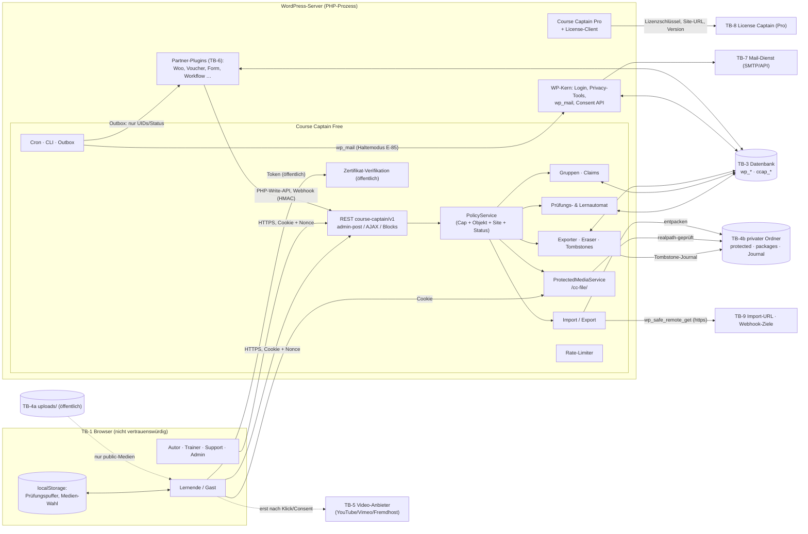

# R0-17 · Threat Model und Datenschutz-Folgenabschätzung

**Status:** **Beschlossen (Auftraggeber/Claude im Auftrag, 16.11.2026) – Beschlüsse eingearbeitet.** Keine Implementierung, kein Testlauf.
**Stand:** 16.11.2026
**Keine Rechtsberatung.** Dieses Dokument beschreibt technische Risiken und Schutzmaßnahmen der Software und liefert Bausteine für die Prüfung durch den Betreiber. Rechtsgrundlagen, Fristen und die Frage, ob eine Datenschutz-Folgenabschätzung (DSFA, Art. 35 DSGVO) nötig ist, beurteilt der **Verantwortliche** (Betreiber der Website) mit seiner Datenschutzberatung. Course Captain gibt keine pauschale Konformitätszusage (Konzept 20).
**Bezug:** TODO R0-17 (DoD: Datenflüsse, Schutzbedarf, Abuse Cases, Prüfungsintegrität, Consent, Lösch-/Exportfristen, DPIA-Bedarf), Folgetasks **R0-31** (Datenschutz- und Sicherheitsdefaults), **R1-17** (Export/Eraser, Retention, Security), **R1-20** (Prüfungsintegrität); Konzept Kap. 20, 35.4, 36, 43.3; `R0-07-rbac-idor-matrix.md` (P-01…P-12, RBAC-001…096, L-W1…L-W11), `R0-08-kurs-activity-pruefungsvertraege.md` (§4.5, §6.4, §6.5), `R0-09-identity-seat-grant-automaten.md` (§1.2, §6, §7), `R0-10-import-medien-sicherheit.md` (§3.1–3.2, §4, §5, IMP-/MED-Tests), `R0-16-backup-recovery-deployment.md` (§2.3, §3.2, REC-Tests), `R0-02-inventar/C` (§2.5, INV-C-055, INV-C-137…160), `R0-02-inventar/D` (INV-D-115, INV-D-145/146, INV-D-154/155).
**Quelle LB:** LearnBoating `hastla007/learnboating` @ `9f37c77`, nur gelesen: `docs/sicherheit-entscheidungen.md`, `docs/datenschutz-organisation.md`, `bootspruefung-learning/src/Security`, `src/Privacy`, dazu `Learning/Services/QuestionPresenter.php` und `Exams/Services/ExamService.php` (Lösungsausgabe).
**Quelle LB (Ergänzung):** Alle LB-Stellen sind Verhaltensreferenz; kein Code wird übernommen (E-01).

### Beschlussstand

Verbindlich sind das Beschlussprotokoll und „Von Claude entschieden“ in `ENTSCHEIDUNGEN.md` (16.11.2026). Die früheren Fragen R17-D1…D9 sind als **E-146…E-154** entschieden (§8). Eingearbeitet:

| Beschluss | Wirkung hier |
|---|---|
| **E-01** Clean Room | Limiter, Eraser, Header usw. werden nach dem LB-Verhalten neu gebaut („LB-Muster“ = Verhaltensvorbild) |
| **E-10**, E-239…E-242, E-260…E-263 | **Website-Härtung im Free-Kern** (R1-45): Login-, Reset- und Registrierungslimit, bekanntes Gerät, XML-RPC, Security-Header website-weit. Zunächst aus, bis der Admin bestätigt; danach je Funktion `auto` (Rückzug bei erkanntem Security-Plugin). Neue Komponente K17 und Bedrohungen T-63…T-67 (§3.2), Rate-Limits §3.4, Header §3.5. Der frühere Hinweis „keine Login-Limits im Free-Kern“ ist überholt |
| **E-46** | fail-closed für Login, Reset, Registrierung, Claim, Einlösen, Einladungen, Datenschutzanträge; Lernen fail-open; bekannte Geräte dürfen weiter einloggen (§3.4) |
| **E-45/E-45a**, E-246 | Externe Medien standardmäßig **ohne Klick-Einwilligung** geladen (`always_load`), umschaltbar auf „Klick zum Laden“. Das Datenschutzrisiko ist als **bewusst akzeptiertes Betreiberrisiko** dokumentiert (§6.5); Offenlegung in der readme, Setup-Hinweis |
| **E-20**, E-147 | Erklärungstexte nur mit Pro ausgeliefert; Free zeigt nach Abgabe richtig/falsch und nach Einstellung die richtige Antwort (T-19, SEC-010) |
| **E-38**, E-39/E-39b, E-182 | Free hat nur die interne Outbox; öffentliche Events, Read-API, Connector-Registry und schreibende Workflow-Aktionen sind Pro (DF-10/DF-11, TB-6) |
| **E-168** | Text-/Dateiaufgaben mit Bewertung in R1: neue Datenkategorie DK-15, Komponente K18, Bedrohungen T-68…T-71, Tests SEC-052…055 |
| **E-92**, **E-151** | Tombstones außerhalb des Datenbestands, automatische Wiederanwendung nach Restore (§5.5) |
| **E-122** | Nachteilsausgleich ohne Begründungstext, im Ergebnis nicht sichtbar; Art.-9-Bewertung §2 |
| **E-04, E-05, E-18, E-27, E-28, E-30, E-43, E-44, E-51, E-65, E-71, E-81, E-82, E-84…E-87, E-97, E-112, E-113, E-116, E-142** | wie angenommen |
| **E-207** | Präfix `ccap_`, Optionen `course_captain_*` (im Text umgestellt) |

---

## 0. Kurzfassung

| Größe | Wert |
|---|---:|
| Angreiferklassen / Vertrauensgrenzen (§1) | 8 / 9 |
| Datenkategorien mit Schutzbedarf (§2) | 15 |
| Komponenten im STRIDE-Raster / Bedrohungen (§3.2) | 18 / 71 |
| Abuse Cases (§3.3) | 14 |
| Testfälle neu (§7) | 55 `SEC-001…055`, 33 `PRIV-001…033` |
| Entscheidungen (§8) | 9 beschlossen (`E-146…E-154`) |

**Kernaussagen**

1. **Größte Restrisiken liegen nicht im Zugriffsschutz, sondern in der Prüfungsintegrität und im Content.** Wer einen Grant hat, kann den Fragenpool im Lernmodus samt Lösungen vollständig abrufen (Parität LB, `QuestionPresenter`); Antworten können nach der Abgabe weitergegeben werden. Das lässt sich drosseln (§3.3 AC-01, E-146/E-147), aber nicht verhindern. Course Captain verspricht **kein Proctoring** (§4).
2. **Partner-Plugins sind keine technische Vertrauensgrenze.** WooCommerce, Voucher, Form usw. laufen im selben PHP-Prozess und können jede Tabelle lesen. Die Grenze ist ein **Vertrag** (Minimalpayload, nur öffentliche API, keine Kopien), kein Schutz gegen bösartigen Code (§1.3 TB-6).
3. **LB-Schwächen werden nicht übernommen:** `default_access = logged_in` (L-W1), öffentliche Paketmedien (L-W7), Monitor-`?key=` (L-W8, INV-C-055), Rate-Limiter fail-open (INV-D-146), Klartext-Tokens (E-112), `sha256(user_id)` als Pseudonym (R0-09 §7), `innerHTML`-Ausnahmen ohne zentrale Bereinigung (INV-D-154).
4. **Löschung nach Restore (E-92):** Tombstones werden pseudonym (HMAC mit dem Schlüssel aus `wp-config.php`) in DB **und** in einem Journal außerhalb des Datenbestands geführt, ein Epochenzähler erkennt den Restore, der Eraser läuft im Haltemodus erneut. Restrisiko: Wird das Journal mit zurückgespielt, ist keine Erkennung möglich (§5.5).
5. **Bewusst akzeptiertes Betreiberrisiko (E-45/E-45a):** Externe Videos laden standardmäßig ohne Einwilligung; dabei gehen mindestens IP-Adresse und Nutzungsdaten an den Videoanbieter, ggf. in ein Drittland. Der Auftraggeber hat das entschieden; der Betreiber kann auf „Klick zum Laden“ umstellen und muss die Rechtslage selbst bewerten (§6.5).
6. **Website-Härtung im Kern (E-10):** Login-, Reset- und Registrierungsgrenzen sind fail-closed (E-46), mit Ausnahme bekannter Geräte und Notausschalter (E-242, E-263); bis zur Admin-Bestätigung aus (E-260).
7. **DSFA:** Für den typischen Einzelanbieter mit erwachsenen Selbstzahlern ist nach der Kriterienliste meist **nur ein Kriterium** erfüllt (Bewertung). Bei **Beschäftigtenschulungen mit Ergebnisweitergabe**, **Minderjährigen/Schulen** und **Zertifikaten mit Berufs- oder Zulassungswirkung** sind regelmäßig zwei oder mehr Kriterien erfüllt; dort ist eine DSFA wahrscheinlich nötig (§6). Course Captain liefert dafür einen Dokumentationsbaustein und eine generierte Verarbeitungsübersicht (E-153), keine fertige DSFA.

---

## 1. Systemabgrenzung, Akteure, Datenfluss

### 1.1 Annahmen zum Angreifermodell

| Nr. | Angreifer / Rolle | Vertrauen | Ziele |
|---|---|---|---|
| A-1 | Anonymer Internetnutzer | keines | Inhalte ohne Kauf, Token erraten, Medien abgreifen, Zertifikate fälschen/ausspähen, DoS, Mail-Relay |
| A-2 | Registriertes Konto ohne Grant | gering | wie A-1, plus IDOR mit eigener Sitzung |
| A-3 | Lernender mit Grant | gering | Prüfungsbetrug, Fragen-Scraping, fremde Ergebnisse, Zugang über Laufzeit hinaus |
| A-4 | Gruppenbesitzer / Käufer | gering | Einladungen weiterreichen, Plätze mehrfach nutzen, Lernstände der Mitglieder sehen |
| A-5 | Autor/Trainer/Support (`ccap_*`-Rolle) | mittel | Rechteausweitung, Stored XSS gegen Admins, fremde Kurse, fremde Antworten ohne Zweck |
| A-6 | Fremdes Inhaltspaket (Import) | keines (Daten) | ZIP-Angriffe, XSS, Polyglot-Dateien, SSRF über Referenzen |
| A-7 | Partner-Plugin / Connector | Vertrag | Datenabfluss, falsche Grant-Ereignisse, Replay |
| A-8 | Netzwerkangreifer | – | TLS vorausgesetzt (Betreiberpflicht); Webhook-Fälschung, Replay |

**Außerhalb des Modells:** kompromittierter Server oder WP-Administrator, Schwachstellen im WordPress-Kern und in Fremd-Plugins (nur Defense in Depth), physischer Zugriff, Social Engineering des Supports (nur organisatorisch, §6.4). Der Site-Admin ist vertrauenswürdig; seine Einsicht in fremde Versuchsdaten wird trotzdem auditiert (R0-07 P-06, E-82).

### 1.2 Datenflussdiagramm

**Textfassung (für Leser ohne Mermaid):**

| Nr. | Fluss | Daten | Schutz |
|---|---|---|---|
| DF-01 | Browser → REST/admin-post | Sitzungscookie, Nonce, Antworten, Formulardaten | TLS (Betreiber), Nonce + Cap (P-04), Rate-Limit (§3.4) |
| DF-02 | REST → Browser | Lektionen, Fragen (ohne Lösung im Versuch), Ergebnisse | Policy je Objekt, `no-store`, P-08 |
| DF-03 | Browser → `/cc-file/` | Medienabruf mit Cookie, Range | M-20, `private, no-store`, kein Pfad |
| DF-04 | Gast → Verifikation | Zufallstoken | Rate-Limit, Minimaldaten, `noindex` |
| DF-05 | Browser ↔ localStorage | gepufferte Prüfungsantworten, Medienwahl | nur eigene Sitzung, Löschen nach Bestätigung/Logout (PRIV-018) |
| DF-06 | Browser → Fremdhost | IP, Referrer, Cookies des Anbieters | Standard `always_load`: **beim Seitenaufruf ohne Einwilligung** (E-45/E-45a, bewusst akzeptiertes Betreiberrisiko §6.5); `youtube-nocookie.com`/`dnt=1`; im Modus `click_to_load` erst nach Klick/Consent (MED-021) |
| DF-07 | Server → Import-URL | GET auf Paket | https, SSRF-Schutz (SEC-029) |
| DF-08 | Server ↔ Dateisystem | Medien, Pakete, Exporte, Journal | private Ablage, `realpath`, Selbsttest (R0-10 §4.4) |
| DF-09 | Server → Mail | Einladung, Abschluss, Datenschutz-Bestätigung | Minimalinhalt (PRIV-021), Haltemodus nach Restore/Staging |
| DF-10 | Outbox → Partner (nur Pro, E-38) | Ereignisse | nur UIDs, Status (Konzept 18, PRIV-023); Free nutzt die Outbox nur intern (Mails, Audit) |
| DF-11 | Partner → Course Captain (Connectoren Pro, E-38/E-53; Workflow-Grant-Quelle E-39b) | Grant-/Revoke-Ereignisse | Connector-Actor, Idempotenz, HMAC bei Webhooks (RBAC-093) |
| DF-15 | Browser → Aufgaben-Abgabe (E-168) | Text, Dateien | Cookie + Nonce, Typprüfung, Ablage `protected`, Auslieferung nur an Abgebende und Bewertende (R0-10 §4.5) |
| DF-16 | Anmeldung → Härtungsmodul (E-10) | Login-Versuche, IP-Hash, Gerätecookie | gesalzene Hashes, fail-closed (E-46), Rückzug bei Security-Plugin (E-240) |
| DF-12 | Pro → License Captain | Lizenzschlüssel, Site-URL, Produkt-/Plugin-Version | keine Lernenden- oder Kursdaten (Konzept 20, SEC-038) |
| DF-13 | WP-Privacy-Tools ↔ CC | Exporter/Eraser je Antrag | WP-Kern-Bestätigung, CC-Registry (§5.2) |
| DF-14 | Monitoring → `/health` | Gesamtstatus; Details nur mit Header-Schlüssel oder Cap | kein `?key=` (RBAC-094) |

### 1.3 Vertrauensgrenzen

| ID | Grenze | Was sie trennt | Wichtigste Regel |
|---|---|---|---|
| TB-1 | Browser ↔ Server | alles aus dem Client ist Eingabe | Serverzeit, Serverbewertung, keine Lösung vor Abgabe (§4) |
| TB-2 | Sitzung ↔ fremde Objekte | Konten untereinander | Policy je Objekt, 404 statt Orakel (P-08), keine `user_id` aus dem Payload (P-09) |
| TB-3 | PHP ↔ Datenbank | Rohdaten, Backups, Dumps | Tokens nur als Hash, Secrets verschlüsselt (E-87), Pseudonyme per HMAC |
| TB-4 | Webroot ↔ privater Ordner | öffentliche vs. geschützte Dateien | Auslieferung nur über PHP, Selbsttest `exposed` (MED-006/007) |
| TB-5 | Site ↔ externe Medien | IP und Nutzungsdaten an Dritte | Standard: direkte Einbettung mit Datenminimierung (E-45a); Betreiberwahl „Klick zum Laden“ mit Consent-Adapter (R0-10 §5); Offenlegung in readme |
| TB-6 | Course Captain ↔ Partner-Plugins | **nur vertraglich**, gleicher Prozess | Minimalpayload, nur öffentliche API, Connector nur auf eigene Quelle (E-39/E-39b, R0-07 §4.8); Connectoren und öffentliche Events nur mit Pro (E-38). Kein Schutz gegen bösartigen Partnercode; Betreiber wählt Plugins aus |
| TB-7 | Site ↔ Mail-Dienst | Empfängeradresse, Inhalt | Minimalinhalt, AV-Vertrag Betreiber, Haltemodus |
| TB-8 | Pro ↔ Lizenzserver | Lizenz- und Site-Daten | Datenliste fix und getestet, Free unabhängig (E-93/E-94) |
| TB-9 | Site ↔ beliebige URLs | SSRF-Ziele | nur https/443, kein privates Netz, Weiterleitungen einzeln geprüft, IP-Pinning (SEC-029) |

**Rollen nach DSGVO (Hinweis, keine Bewertung):** Verantwortlicher für Lernende ist der Betreiber. Course Captain (Free, selbst gehostet) verarbeitet keine Daten beim Hersteller. Bei Pro empfängt der Hersteller über License Captain Lizenz- und Site-Daten (DF-12) und ist dafür voraussichtlich selbst Verantwortlicher. Videoanbieter und Mail-Dienste sind Empfänger bzw. Auftragsverarbeiter des Betreibers (Konzept 20).

---

## 2. Datenkategorien und Schutzbedarf

Skala nach üblicher Schutzbedarfsfeststellung: **normal / hoch / sehr hoch**, getrennt nach Vertraulichkeit (V), Integrität (I), Verfügbarkeit (A). Bewertet ist der typische Einsatz; Abweichungen in der Spalte „erhöht, wenn …“.

| Nr. | Kategorie | Beispiele / Ort | Betroffene | V | I | A | erhöht, wenn … | Retention-Default |
|---|---|---|---|---|---|---|---|---|
| DK-01 | **Identität** | WP-User (Name, E-Mail, Login), `ccap_grant.user_id`, `ccap_seat.user_id`, Gruppen-Besitzer | Lernende, Käufer, Staff | hoch | hoch | normal | Minderjährige, Beschäftigte | WP-Kern; Kontolöschung nur Opt-in (E-43) |
| DK-02 | **Einladungsadressen** | `ccap_seat.invite_email` (auch Personen ohne Konto) | Eingeladene | hoch | normal | normal | – | bis Claim, sonst 30 d nach Ablauf (R0-09 §7) |
| DK-03 | **Lernverhalten** | `ccap_question_progress`, `ccap_attempt(_answer)` inkl. Antwortzeit, Smarttrainer-Stand, Video-Position, Favoriten, Sammlungsnamen | Lernende | hoch | normal | normal | Arbeitgeber sieht Daten (Leistungs-/Verhaltenskontrolle) | bis Kontolöschung (E-51), E-154 |
| DK-04 | **Prüfungsergebnisse** | `ccap_exam_session` (Punkte, bestanden, Zeit), `ccap_exam_session_question` (Rohantworten, Markierung, Freitext) | Lernende | **hoch** | **sehr hoch** | hoch (laufende Prüfung) | Ergebnis hat Berufs-, Zulassungs- oder Arbeitsfolgen | Versuche 10 J., Rohantworten 2 J. nach Kursende (E-51), E-150 |
| DK-05 | **Zertifikate** | `ccap_certificate` (Snapshot mit Name, Kurs, Datum, Verifikations-Hash) | Lernende, Dritte (Prüfer) | normal (öffentlich minimal) | **sehr hoch** | hoch (Verifikation) | Zertifikat als Nachweis gegenüber Dritten | 10 J. (E-51), Name öffentlich nur Opt-in (E-97) |
| DK-06 | **Zugangsrechte** | `ccap_grant`, `ccap_grant_event`, Quelle, Laufzeit | Lernende, Käufer | normal | **sehr hoch** | hoch | – | 10 J. pseudonymisiert für Kaufquellen (E-44, R0-09 §7) |
| DK-07 | **Zahlungsbezug (nur Referenzen)** | `source_id` (Bestell-UID), Quelltyp; **keine** Beträge, Karten-, Steuer- oder Adressdaten (Konzept 20, R0-06 E-38) | Käufer | normal | hoch | normal | – | wie DK-06; Bestellungen selbst verwaltet WooCommerce |
| DK-08 | **Gruppenmitglieder** | `ccap_seat` (Status, beigetreten, entfernt), `ccap_group.name` (kann Personen-/Firmennamen enthalten) | Mitglieder, Besitzer | hoch | hoch | normal | Firmen-/Schulgruppen | Gruppenzeilen: R0-31 (LB: keine Frist) |
| DK-09 | **Tokens und Geheimnisse** | Claim-/Gruppen-/Verifikations-Token (nur Hash), Connector-Secrets, `COURSE_CAPTAIN_SECRET_KEY`, Monitor-Key | – | **sehr hoch** | sehr hoch | normal | – | Hash bis Claim/Rotation; Secrets R0-16 §3.2 |
| DK-10 | **Audit** | `ccap_audit_log` (Akteur, Aktion, Objekt, Grund), keine IP | alle | hoch | **sehr hoch** | normal | – | 4 J., pseudonymisiert (E-44) |
| DK-11 | **Rate-Limit-Zähler** | gesalzener Hash aus IP/Konto, Fenster | alle, auch Angreifer | normal | normal | hoch | – | Fensterende + Cron (LB `RateLimiter::cleanup`) |
| DK-12 | **Inbox/Outbox, Diagnose, gehaltene Mails** | Ereignis-Payload (UIDs), Fehlertexte, `held`-Mails mit Empfänger | Lernende | normal | hoch | normal | – | 90 d (E-116); gehaltene Mails E-151 Abs. 4 |
| DK-13 | **Kursinhalte, Fragen, Lösungen** | CPT, `ccap_question_revision`, Paketkopien | Autoren (Urheber) | **hoch** (Lösungen) | hoch | normal | kommerzieller Fragenkatalog | Revisionen dauerhaft (R0-06) |
| DK-14 | **Datenschutz-Tombstones** | HMAC(Nutzer), HMAC(E-Mail), Zeitpunkt, Umfang | gelöschte Personen | hoch | **sehr hoch** | hoch | – | E-151 |
| DK-15 | **Aufgaben-Abgaben** (E-168) | Freitext, hochgeladene Dateien (beliebiger Inhalt, ggf. Metadaten wie Autor/Ort), Bewertung, Rückmeldung | Lernende, Bewertende | **hoch** | hoch | normal | Dateien mit Personen-, Gesundheits- oder Firmendaten | Annahme E-51 „Rohantworten 2 J. nach Kursende“, siehe Offene Punkte |

**Besondere Kategorien (Art. 9) und Minderjährige:** Course Captain verarbeitet planmäßig keine Daten nach Art. 9. Freitext-Antworten (`open_text`, Sammlungsnamen, Abgaben nach E-168) können solche Daten aber zufällig enthalten; deshalb gilt für DK-03/DK-04 Vertraulichkeit „hoch“, und Freitext wird nie in Mails, Outbox oder Berichts-CSVs übernommen. Course Captain erfindet keine Altersprüfung (Konzept 20); für Kinder- und Schulangebote siehe §6.3 Szenario S-3.

**Nachteilsausgleich (E-122, Art.-9-Bewertung):** Ein Zeitfaktor (100–400 % oder ohne Limit) lässt auf eine Beeinträchtigung schließen und kann damit mittelbar Gesundheitsdaten (Art. 9) offenbaren. Maßnahmen nach E-122: Vergabe nur durch Berechtigte, **kein Begründungstext** gespeichert, Faktor im Snapshot eingefroren, in Ergebnis und Nachweis (Zertifikat, Verifikation, Berichte, Mails, Outbox) **nicht sichtbar**; Einsicht wie Versuchsdaten nur mit Pflichtbegründung (E-82). Aufbewahrung wie der Versuch (E-51). Die rechtliche Einordnung trifft der Betreiber.

---

## 3. Bedrohungen

### 3.1 Vorgehen

STRIDE je Komponente (S = Spoofing, T = Tampering, R = Repudiation, I = Information Disclosure, D = Denial of Service, E = Elevation of Privilege). Jede Zeile hat eine Gegenmaßnahme und mindestens einen Test. Vorhandene Testkataloge werden referenziert statt dupliziert: `RBAC-xxx` (R0-07), `ID-/SEAT-xxx` (R0-09), `IMP-/MED-xxx` (R0-10), `REC-xxx` (R0-16), `CORE-xx` (Konzept 35.5). Neue Tests in §7.

### 3.2 STRIDE je Komponente

| ID | Komponente | STRIDE | Bedrohung | Gegenmaßnahme | Test | Ziel-Task |
|---|---|---|---|---|---|---|
| T-01 | K1 Lern-SPA (Browser) | S | Sitzungsklau über XSS | WP-Auth-Cookies `HttpOnly` (Kern); `textContent` als Regel; zentrale `SafeRichText`-Komponente; CSP auf CC-Antworten (T-05) | SEC-005, SEC-007 | R1-16 |
| T-02 | K1 | T | Timer, `age_ms` oder Client-Zeitstempel manipuliert | Serverzeit maßgeblich, Kulanz im Snapshot begrenzt (R0-08 §6.4); Client-Timer nur Anzeige | SEC-011, SEC-012 | R1-20 |
| T-03 | K1 | I | Lösungen im DOM, JS-Bundle oder in REST-Antworten **vor** Abgabe | Server liefert im laufenden Versuch keine Felder `correct*`, `is_correct`, `explanation`, `feedback_*` (R0-08 §4.5); Bundle enthält keine Inhalte | SEC-009 | R1-08, R1-20 |
| T-04 | K1 | I | Prüfungspuffer im localStorage auf geteiltem Gerät | Puffer nur für die laufende Sitzung (Schlüssel = Session-UID), ohne Lösungen; Löschen nach Server-Bestätigung, Abgabe und Logout | PRIV-018 | R1-20 |
| T-05 | K1 | E | **Stored XSS** über Fragen, Antworten, Feedback, FAQ/Tipps (LB `innerHTML`, INV-D-154) gegen Lernende und Admins | Speichern: `wp_kses` mit CC-Allowlist (kein `unfiltered_html` für `ccap_*`-Rollen); Ausgabe: `SafeRichText` als einzige `innerHTML`-Stelle, lokal gebündelter Sanitizer, CSP ohne `unsafe-inline` für Skripte; CI-Lint gegen `innerHTML` außerhalb | SEC-005, SEC-006, SEC-044 | R1-06, R1-16 |
| T-06 | K2 REST / admin-post / AJAX | S | **CSRF** auf Grant, Claim, Abgabe, Datenschutzantrag, Settings | Nonce je Aktion und Objekt (P-04) **und** Cap; WP setzt kein `SameSite` auf Auth-Cookies, darum keine Ausnahme ohne Nonce; Claim/Löschen nie per GET (ID-004) | SEC-001, RBAC-079 | R1-03, R1-28 |
| T-07 | K2 | T | **IDOR** / Mass Assignment (`user_id`, `owner`, `status` im Payload) | P-02, P-09; Schema-Allowlist je Route | SEC-003, SEC-004, RBAC-001…096 | R1-03 |
| T-08 | K2 | I | Existenz-Orakel über 403/404, Zeitverhalten, `_links` | P-08 (404 byte-gleich), RBAC-096 | RBAC-096 | R1-03 |
| T-09 | K2 | E | Route ohne echte `permission_callback` | Routeninventar im CI; `__return_true` nur für Allowlist (Verifikation, Health-Gesamtstatus) | SEC-002 | R1-28 |
| T-10 | K2 | D | teure Endpunkte (Berichte, Exporte, Suche) | Pagination, Obergrenzen, Rate-Limit, asynchrone Exporte | SEC-023, R0-14 | R1-22 |
| T-11 | K3 PolicyService | E | Fremdcode gewährt Zugang über Filter | Filter darf nur einschränken (E-84) | SEC-037 | R1-03 |
| T-12 | K3 | E | Rechteausweitung über Rollen-Tab | RBAC-091; `administrator` nicht wählbar | RBAC-091, SEC-044 | R1-03 |
| T-13 | K3 | R | Staff liest fremde Versuche ohne Spur | Pflichtbegründung + Audit (E-82) | PRIV-020 | R1-03 |
| T-14 | K4 Lernmodus / Fragenauslieferung | I | **Fragen-Scraping** samt Lösungen durch Lernende mit Grant | Frage-Token HMAC mit Nutzerbindung (RBAC-022); 60 Antworten/min; keine Sammel-Endpunkte für Fragen; Kennzahl „verschiedene Fragen je Nutzer und Tag“ im Dashboard; optional prüfungsexklusive Fragen (E-146) | SEC-018, SEC-019 | R1-12, R1-06 |
| T-15 | K4 | T | Antwort mit fremdem/abgelaufenem Token | RBAC-022, RBAC-027, RBAC-028 | – | R1-03 |
| T-16 | K5 Prüfungsautomat | T | Doppelabgabe, `submit` parallel zu Cron | `FOR UPDATE`, CAS `row_version`, ein Ergebnis (R0-08 Testanker) | SEC-014 | R1-20 |
| T-17 | K5 | T | **Mehrere Tabs/Geräte** schreiben denselben Versuch | Zeilensperre, letzter inhaltlicher Stand gewinnt; Hinweis „in anderem Fenster geöffnet“ (E-149) | SEC-013 | R1-20 |
| T-18 | K5 | I | **Antwort-Leak vor Abgabe**: `open_text`-Musterantwort nach `reveal`, Lösungen nach Abbruch | Musterantwort ist Designgrenze der Selbsteinschätzung (Publish-Validator warnt bei bewerteter Prüfung mit `open_text`); Abbruch zählt gegen `max_attempts` (E-71); keine Lösungen nach `abort` | SEC-009, SEC-015, SEC-046 | R1-08, R1-26 |
| T-19 | K5 | I | Weitergabe von Lösungen nach Abgabe an andere | `show_correct_answers` nur, wenn keine weiteren Versuche offen (E-147); Varianten, Zufallsziehung, Antwortreihenfolge je Versuch | SEC-010 | R1-09 |
| T-20 | K5 | D | Prüfungsstart-Flut, „Abbrechen zum Ansehen“ | Start-Limit 40/h (R0-08 §6.5), E-71, `NamedLock exam_start` | SEC-015 | R1-08 |
| T-21 | K5 | R | Lernender bestreitet Abgabe oder Zeitpunkt | Zeitstempel je Antwort, `snapshot_hash`, `end_reason`, Audit | SEC-014 | R1-08 |
| T-22 | K5 | E | Prüfung ohne Scope `exam` oder nach Widerruf | M-08, RBAC-037, E-113 | RBAC-037 | R1-03 |
| T-23 | K6 Geschützte Medien | I | **Öffentliche Medien-URLs** (LB L-W7) | Speicherklasse `protected` als Standard (E-65), Zugriff nur über `media_uid` | MED-001…006, SEC-033 | R1-14 |
| T-24 | K6 | I | Seiten-/CDN-Cache speichert geschützte Antwort | `Cache-Control: private, no-store`, `Vary: Cookie`; Test mit Cache-Plugin | SEC-032 | R1-14, R1-30 |
| T-25 | K6 | I | Fehlkonfiguration Nginx/IIS (`.htaccess` wirkt nicht) | Selbsttest `exposed` kritisch, Regeltext (R0-10 §4.4) | MED-007 | R1-38 |
| T-26 | K6 | D | Massendownload, Range-Flut | Rate-Limit je Nutzer und Medium (§3.4), fail-open | SEC-023 | R1-14 |
| T-27 | K7 Import | T/E | **ZIP-Slip, Symlink, ZIP-Bombe**, gefälschte Größen | R0-10 §3.2 V1–V3, Byte-Zähler | IMP-006…011, SEC-028 | R1-15 |
| T-28 | K7 | E | Polyglot-/Skriptdateien, SVG | V4 Allowlist, `finfo`, SVG nie (R0-10) | IMP-012/013, RBAC-076 | R1-15 |
| T-29 | K7 | E | Stored XSS über Paket-HTML | V6 HTML-Filter + Dry-run-Diff | IMP-016, SEC-005 | R1-15 |
| T-30 | K7 | I/E | **SSRF** über Import-URL (Cloud-Metadaten, Intranet, DNS-Rebinding) | nur `https` und Port 443; `wp_safe_remote_get` plus eigene IP-Prüfung jeder aufgelösten Adresse und **IP-Pinning** für die Verbindung (verhindert Rebinding zwischen Prüfung und Abruf); Weiterleitungen einzeln (≤ 3); Größenlimit | SEC-029, RBAC-081 | R1-15 |
| T-31 | K7 | I | externe Medien-URL im Paket wird vom Server abgerufen | Server ruft nie ab (MED-026); Embed-URL wird aus Provider-Registry gebaut, kein oEmbed-Abruf | MED-026 | R1-15 |
| T-32 | K8 Gruppen / Claims | S | **Token-Bruteforce** (Claim, Gruppenlink) | 256 Bit, nur Hash (E-112), Formatprüfung vor DB, Rate-Limit fail-closed (E-46) | SEC-020, ID-005 | R1-13 |
| T-33 | K8 | I | Token-Leck über Referer, Logs, Audit, Export | `Referrer-Policy: no-referrer`, `no-store`, nie in Logs/Audit/Export (R0-09 §1.2) | SEC-021, ID-002 | R1-13 |
| T-34 | K8 | I | **Einladungs-Sharing** (weitergeleitete Mail/Link) | Standard `transferable` (E-28) ist bewusst; Option `invited_address_only`; Platzgrenze; Rotation; Kennzahl Umverteilungen (E-115) | SEAT-014/015, ID-007 | R1-13 |
| T-35 | K8 | D | Mail-Relay über Einladungen | Budget max(20, 2 × Plätze)/24 h, fail-closed | SEAT-022, SEC-023 | R1-13 |
| T-36 | K8 | T | Race um den letzten Platz | R0-09 §6 (R-01…R-03) | SEAT-003…005 | R1-42 |
| T-37 | K8 | I | Besitzer sieht Adressen/Lernstand der Mitglieder | E-81, RBAC-036/059 | SEAT-017, PRIV-019 | R1-13 |
| T-38 | K9 Zertifikat-Verifikation | S | gefälschtes PDF/Ausdruck | Verifikationsseite ist Quelle der Wahrheit; PDF trägt Link/QR; kein Versprechen „fälschungssicher“ (§4.3) | SEC-034 | R1-35 |
| T-39 | K9 | I | Aufzählung/Verzeichnis fremder Nachweise, Suchmaschinen | Token 256 Bit, kein Listing, `noindex`, Name nur Opt-in (E-97), Rate-Limit | SEC-034, PRIV-025 | R1-35 |
| T-40 | K9 | T | widerrufenes Zertifikat erscheint gültig (Cache) | kurze/keine Cachezeit, Invalidierung bei Statuswechsel | SEC-034 | R1-35, R1-25 |
| T-41 | K10 Exporter / Eraser | I | Export an falsche Person | WP-Kern-Bestätigungsmail; Self-Service nur eigenes Konto (RBAC-086); keine Drittdaten im Klartext (ID-013) | PRIV-002, PRIV-015 | R1-17 |
| T-42 | K10 | T | **unvollständige Löschung** (neue Tabelle vergessen) | Personendaten-Registry (R0-06) + CI-Schema-Scan | PRIV-001, PRIV-003 | R1-17 |
| T-43 | K10 | R | Nachweis der Löschung fehlt | pseudonymer Audit-Eintrag + Tombstone (§5.5) | PRIV-009 | R1-17 |
| T-44 | K10 | T | **Wiederauferstehung nach Restore** | Tombstones, Epochenerkennung, Nachlauf im Haltemodus (E-92) | PRIV-010…013 | R1-23 |
| T-45 | K10 | I | Pseudonym rückrechenbar (`sha256(user_id)`, LB INV-C-152) | HMAC-SHA-256 mit Site-Geheimnis (R0-09 §7) | PRIV-005 | R1-17 |
| T-46 | K11 Cron / CLI | E | Job mit manipulierten IDs | Zustand neu laden, Site prüfen (RBAC-090); CLI = Systemakteur mit Audit | RBAC-090 | R1-03 |
| T-47 | K11 | D | Cron-Rückstau verhindert Ablauf | Ablauf zur Laufzeit geprüft (L-S8), Cron nur kosmetisch | RBAC-009 | R1-17 |
| T-48 | K12 Outbox / Webhooks / Connectoren | S | gefälschter oder wiederholter Webhook | HMAC `hash_equals`, Zeitfenster ± 5 min, Dedupe `UNIQUE(connector_id, event_id)` | RBAC-093, SEC-026 | R3-01 |
| T-49 | K12 | T | **Gutschein-Race** (Doppeleinlösung, Reserve ohne Commit) | Reserve/Grant/Commit mit Idempotenzschlüssel, Lock je Code, Unique (CORE-03/08) | SEC-024, SEC-025 | R3-04, R3-05 |
| T-50 | K12 | I | Payload mit E-Mail/Name an Partner | nur UIDs/Status (Konzept 18) | PRIV-023 | R1-28, R3-12 |
| T-51 | K12 | I/E | Partner-Plugin liest CC-Tabellen direkt | nicht verhinderbar (TB-6); keine Tabellen als API dokumentiert; Hinweis in Betreiberdoku | SEC-039 | R1-28, R1-24 |
| T-52 | K12 | I | SSRF über ausgehende Webhook-Ziele (Pro) | gleiche Prüfung wie T-30 | SEC-030 | R3-08 |
| T-53 | K13 Mail | I | Mails nach Restore/auf Staging an echte Personen | Haltemodus (E-85), `catch` außerhalb Produktion (E-86) | REC-016, REC-021 | R1-23 |
| T-54 | K13 | I | Ergebnisse/Freitext in Mails | Mail nennt nur „Ergebnis liegt vor“ + Link; kein Freitext, keine Punktzahl als Default | PRIV-021 | R1-21 |
| T-55 | K13 | T | Header-Injection über Gruppenname/Adresse | Bereinigung, `wp_mail`-Header nie aus Nutzereingaben | SEC-040 | R1-21 |
| T-56 | K14 Lizenzclient (Pro) | I | Lernenden- oder Kursdaten an Lizenzserver | feste Feldliste (DF-12), Test mit Mitschnitt | SEC-038 | R3-18 |
| T-57 | K14 | T | manipuliertes Update | WP.org (Free) bzw. signierter License-Captain-Kanal (R0-39) | R0-18 | R3-18 |
| T-58 | K15 Settings / Secrets / Health | I | **Monitor-Schlüssel per `?key=`** in Logs (LB L-W8) | nur Header `X-CC-Monitor-Key` (Name R0-19), `hash_equals`; ohne Konstante nur Gesamtstatus | SEC-035, RBAC-094 | R1-38 |
| T-59 | K15 | I | Secrets in Settings-Export, Site Health, Logs | R0-16 §3.2, E-87 | REC-022 | R1-23 |
| T-60 | K16 Rate-Limiter | D/S | **fail-open bei Zählerausfall** (LB INV-D-146) | Zweckgetrennt nach E-46 (§3.4) | SEC-023 | R1-42, R1-03 |
| T-61 | K16 | S | IP-Spoofing über `X-Forwarded-For` | nur eingetragene Proxys (INV-D-115), IPv6 je /64 | SEC-022 | R1-42 |
| T-62 | K16 | I | Zähler enthalten Klartext-IP/E-Mail | nur gesalzener Hash (INV-D-146) | PRIV-027 | R1-17 |

| T-63 | K17 Härtungsmodul (E-10, R1-45) | S | **Brute Force** auf Login, Passwort-Reset, Registrierung über alle Wege (`wp-login`, XML-RPC, REST Basic/Anwendungspasswort, Woo-Konto) | gemeinsame Zähler nach R0-31 §3.4; fail-closed (E-46) | SEC-047, SEC-048 | R1-45 |
| T-64 | K17 | D | **Selbstaussperrung** von Admins bei Zählerausfall (fail-closed) | bekannte Geräte (Cookie) dürfen weiter (E-46, E-263); Notausschalter `COURSE_CAPTAIN_HARDENING` und WP-CLI (E-242) | SEC-049 | R1-45 |
| T-65 | K17 | D/T | **Doppelsperren/Konflikte** mit Security-Plugins | Modus `auto` zieht sich bei erkanntem Plugin zurück (E-240); Konfliktmatrix R0-20 Pflicht (E-10) | SEC-050 | R1-45, R1-30 |
| T-66 | K17 | I | User-Enumeration über Reset-Antwort | gleiche Bestätigung für unbekannte Konten (R0-31 §3.4); weiterer Enumeration-Schutz nicht in R1 (E-241/E-261) | SEC-048 | R1-45 |
| T-67 | K17 | E | Härtung unbemerkt aktiv bzw. inaktiv | Default aus bis Admin-Bestätigung (E-260), Zustand je Funktion im Systemstatus (R0-13 H-38), `off`/`force` nur mit Bestätigung und Audit | SEC-051 | R1-45, R1-32 |
| T-68 | K18 Aufgaben-Abgaben (E-168) | E/T | **Schadhafte Datei** (Polyglot, `x.php.pdf`, SVG/HTML mit Skript) | Allowlist + innere Endung + `finfo`, Ablage `protected` außerhalb Webroot, Auslieferung mit `nosniff`, `CSP: sandbox`, `attachment` (R0-10 §4.5) | SEC-052 | R1-46, R1-14 |
| T-69 | K18 | I | **IDOR** auf fremde Abgaben | Policy je Objekt: nur Abgebende und Bewertende, 404 ohne Existenzauskunft (P-08) | SEC-053 | R1-14 |
| T-70 | K18 | D | Speicherfüllung durch viele/große Uploads | Größenlimit, Rate-Limit je Nutzer und Aufgabe, Upload nur im Entwurf | SEC-054 | R1-46 |
| T-71 | K18 | R | Bewertung oder Abgabezeitpunkt bestritten | Zustände `draft/submitted/returned/graded` mit Zeitstempel und Audit, Datei-Hash bei Abgabe | SEC-055 | R1-46 |

**Hinweis zu E-10 (überholt und ersetzt):** Nach dem Beschluss E-10 gehört die Website-Härtung **in den Free-Kern** (Task R1-45, E-239). Fail-closed nach E-46 gilt damit im Free-Kern für Login, Passwort-Reset und Registrierung ebenso wie für Claim, Einlösen, Einladungen und Datenschutzanträge (Komponente K17, §3.4). Bis der Admin im Assistenten oder im Tab „Website-Härtung“ bestätigt, ist alles aus (E-260); danach gilt je Funktion `auto` (E-240). Die Betreiberdoku empfiehlt zusätzlich Zwei-Faktor für Konten mit `ccap_*`-Verwaltungsrechten (Verhalten nach LB `sicherheit-entscheidungen.md` §3).

### 3.3 Abuse Cases

| ID | Abuse Case | Akteur | Ablauf | Gegenmaßnahme | Restrisiko | Tests |
|---|---|---|---|---|---|---|
| **AC-01** | **Fragen-Scraping** | A-3 | Skript ruft im Lernmodus `next-question`/`answer` in Schleife ab und sammelt Fragen samt `correct_ids` (Lernmodus zeigt Lösungen sofort, R0-08 §4.5) | 60 Antworten/min, Frage-Token mit Nutzerbindung, kein Bulk-Endpunkt, Kennzahl im Dashboard, Kurs-Export nur Staff (RBAC-088); optional prüfungsexklusive Fragen (E-146) | Ein geduldiger Lernender sammelt den ganzen Lernpool in Tagen; Screenshots bleiben möglich | SEC-018, SEC-019 |
| **AC-02** | **Prüfungsbetrug: Mehrfachtabs/Geräte** | A-3 | Versuch in zwei Tabs oder auf zwei Geräten (zweite Person) offen | Serialisierung je Antwort, ein laufender Versuch je Prüfung, Hinweis bei paralleler Nutzung (E-149); Abgabe einmalig | Zweite Person am zweiten Gerät ist technisch nicht erkennbar (§4) | SEC-013, SEC-014 |
| **AC-03** | **Prüfungsbetrug: Zeitmanipulation** | A-3 | Systemzeit verstellen, `age_ms` fälschen, offline gehen und nach Frist nachsenden | Serverfrist; nachgesendete Antworten nur innerhalb Kulanz und begrenzt auf `started_at…now`; strenger Modus Kulanz 0 (R0-08 §6.4) | Innerhalb der Kulanz kann ein Lernender bis zu `late_tolerance` Sekunden gewinnen (Designgrenze) | SEC-011, SEC-012 |
| **AC-04** | **Antwort-Leak vor Abgabe** | A-3 | (a) Lösungen aus REST-/DOM-Daten lesen; (b) Versuch abbrechen und Lösungen ansehen; (c) `open_text`-Musterantwort aufdecken und „gewusst“ wählen; (d) Fragen im Lernmodus parallel nachschlagen | (a) keine Lösungsfelder vor `evaluated`; (b) keine Lösungen nach `abort`, Abbruch zählt (E-71); (c) Validator-Warnung, `open_text_in_score` (R0-08); (d) Fragen der laufenden Prüfung im Lernmodus gesperrt (G-5) | (c) ist Designgrenze; (d) gilt nur für dieselben Fragen, nicht für Suchmaschine/Notizen | SEC-009, SEC-015, SEC-016 |
| **AC-05** | **Antwort-Weitergabe nach Abgabe** | A-3 → andere | Ergebnisansicht mit richtigen Lösungen wird geteilt; Lernender macht danach einen zweiten Versuch | E-147; Zufallsziehung, Varianten, Antwortmischung je Versuch | Bei kleinem Pool bleibt Weitergabe wirksam | SEC-010 |
| **AC-06** | **Token-Bruteforce** | A-1/A-2 | Claim-/Gruppenlink-/Verifikations-Token durchprobieren | 256 Bit (Raum 2²⁵⁶), Rate-Limit je IP/Konto, fail-closed für Claim | praktisch keins | SEC-020, ID-005 |
| **AC-07** | **Einladungs-Sharing** | A-4 / Mitglied | Gruppenlink in Foren posten; persönliche Einladung weiterleiten; Platz nach Prüfung umverteilen | Platzgrenze; `invited_address_only` (deaktiviert Gruppenlink); Rotation; Umverteilungs-Kennzahl (E-115); Vorschau zeigt maskierte Adresse (ID-007) | Bei `transferable` ist Weitergabe gewollt; Kontrolle beim Besitzer | SEAT-014/015, ID-007 |
| **AC-08** | **Gutschein-Race** | A-2/A-3 | dieselbe Gutscheinnummer parallel aus mehreren Sitzungen einlösen; Abbruch zwischen Reserve und Commit | Voucher Captain reserviert; Course-Grant mit Idempotenzschlüssel; Lock je Code; Kompensation (CORE-03/08) | – | SEC-024, SEC-025 |
| **AC-09** | **IDOR** | A-2…A-5 | fremde Versuch-, Gruppen-, Datei-, Export-IDs | Policy je Objekt, 404 (P-08) | – | RBAC-001…096, SEC-003 |
| **AC-10** | **CSRF** | A-1 | fremde Seite sendet Formular an Claim/Grant/Löschantrag | Nonce + Cap, kein GET mit Wirkung | – | SEC-001, ID-004 |
| **AC-11** | **Stored XSS** in Fragen/FAQ/Tipps, `innerHTML`-Ausnahmen (INV-D-154) | A-5, A-6 | Autor oder Paket legt `` in Feedback; Admin öffnet Vorschau | kses beim Speichern, `SafeRichText` + CSP bei Ausgabe, CI-Lint, kein `unfiltered_html` für `ccap_*` | Admin mit `unfiltered_html` (WP-Kern) bleibt vertrauenswürdig | SEC-005, SEC-006, SEC-044 |
| **AC-12** | **ZIP-Import-Angriffe** | A-6 | Bombe, Slip, Symlink, Polyglot, Unicode-Kollision, tiefe Verschachtelung | R0-10 V1–V6, Byte-Zähler, Zufallsordner | – | IMP-006…016, SEC-028 |
| **AC-13** | **SSRF bei Import-URL** | A-5 (Import-Recht) | `https://169.254.169.254/…`, Weiterleitung ins Intranet, DNS-Rebinding | T-30 | Admin mit Shell ist ohnehin vertrauenswürdig; Schutz gilt für delegierte Import-Rechte | SEC-029, RBAC-081 |
| **AC-14** | **Öffentliche Medien-URLs** | A-1 | geratene/kopierte URL eines Prüfungsbildes oder PDFs, Suchmaschinen-Index | `protected` Default, keine Pfade in REST/Feeds/Sitemaps/`og:image`, Selbsttest | Bilder mit `access=public` bewusst öffentlich | SEC-032, SEC-033, MED-006 |

### 3.4 Rate-Limits und Ausfallverhalten (E-152, E-46)

Werte als änderbare Defaults (Filter/Setting nach R0-27). Zähler nach LB-Verhalten atomar, vorgemerkt, Name nur als gesalzener Hash (INV-D-146); Client-IP nur über eingetragene Proxys, IPv6 je /64 (INV-D-115). Der Limiter wandert aus dem Mobile-Namensraum in den Kern (INV-D-145).

| Einstieg | Grenze | bei Zählerausfall | Quelle |
|---|---|---|---|
| Login (alle Wege über `wp_authenticate`, Härtungsmodul) | 10 je IP, 5 je Konto+IP, 30 je Konto in 15 min (R0-31 §3.4) | **fail-closed**; bekannte Geräte dürfen weiter (E-46, E-263) | E-10, E-46, E-242 |
| Passwort-Reset (Härtungsmodul) | 10 je IP, 3 je Konto+IP, 10 je Konto je h (R0-31 §3.4) | **fail-closed** | E-10, E-46 |
| Registrierung (nur bei `users_can_register`) | 10 je IP je h (R0-31 §3.4) | **fail-closed** | E-46, E-241 |
| Claim-Vorschau und Einlösen (Einladung, Gruppenlink) | 30 je IP/h, 10 je Konto/h | **fail-closed** (503 mit Hinweis) | R0-09 §1.2, E-46 |
| Gutschein einlösen (R3, alle Wege zusammen) | 30 je IP/h, 10 je Konto/h | **fail-closed** | INV-B-162, E-46 |
| Einladungen versenden | max(20, 2 × Plätze) je Gruppe/24 h | **fail-closed** (Mail-Relay) | INV-B-041; Erweiterung von E-46 |
| Datenschutzantrag (Self-Service) | 3 je Konto/Tag, 10 je IP/h | **fail-closed** (löst Mails aus) | LB `SelfService.php:93`; Erweiterung von E-46 |
| Zertifikat-Verifikation (öffentlich) | 30 je IP/min | fail-open (Token 256 Bit) | Konzept 35.4 |
| Antworten Lernmodus | 60 je Nutzer/min | fail-open | LS:40 |
| Antworten/Markierungen im Prüfungsversuch | 120 je Versuch/min | fail-open | neu (Ausfall darf keine Prüfung abbrechen) |
| Prüfungsstart | 40 je Nutzer/h | fail-open | R0-08 §6.5 |
| Geschützte Medien | 300 verschiedene `media_uid` je Nutzer/h (Range-Anfragen derselben Datei zählen nicht) | fail-open | R0-10 §4.3 Nr. 6 |
| Aufgaben-Upload (E-168) | je Nutzer und Aufgabe; Wert offen (R0-10 OP-10-2) | fail-open (Lernen) | R0-10 §4.5 |
| Import-URL, Kurs-Export, Bericht-CSV | 10 je Konto/h | fail-closed | neu |
| Health/Monitor | 60 je IP/min | fail-open (nur Gesamtstatus) | neu |

Jeder Ausfall erzeugt eine Site-Health-Warnung und höchstens einen Logeintrag je 10 min (Drosselverhalten wie LB). Die Limits der Härtungsfunktionen wirken nur, solange die jeweilige Funktion aktiv ist (bestätigt, `auto` ohne erkanntes Security-Plugin oder `force`).

### 3.5 Sicherheits-Header (E-10, E-224, E-261)

**Website-weit (Härtungsmodul, Funktion `site_headers`):** vier Security-Header nach R0-31 §3.4 (E-261), nur nach Admin-Bestätigung und im Modus `auto` mit Rückzug bei erkanntem Security-Plugin (E-240, E-260).

**Eigene Antworten (immer):** Course Captain setzt auf seine eigenen Antworten (Lernbereich-Seite, REST `course-captain/v1`, `/cc-file/`, Verifikation): `X-Content-Type-Options: nosniff`; `Cache-Control: private, no-store` für personenbezogene Antworten; `Referrer-Policy: no-referrer` auf Claim- und Verifikationsseiten, sonst `strict-origin-when-cross-origin`; `Content-Security-Policy` für die Lern-SPA mit `script-src 'self'` plus Nonce, `frame-src` nur für registrierte Video-Hosts (im Modus `click_to_load` erst nach Einwilligung, E-45a), `object-src 'none'`, `base-uri 'self'`; Default `enforce`, Umschalten auf `report_only` nur mit Bestätigung (E-224; Theme-Konflikte prüft R1-30). Dateien: `Content-Security-Policy: sandbox` außer PDF (R0-10 §4.3).

---

## 4. Prüfungsintegrität: was technisch geht und was nicht

### 4.1 Technisch umgesetzt (Ziel R1-08/R1-20)

| Nr. | Maßnahme | Wirkung | Beleg/Test |
|---|---|---|---|
| PI-01 | Serverzeit, Frist im Snapshot, Kulanz begrenzt | Timer-Manipulation wirkungslos außerhalb der Kulanz | R0-08 §6.4, SEC-011/012 |
| PI-02 | Bewertung nur serverseitig gegen eingefrorene Revisionen | Client kann Punkte nicht setzen | R0-08 §6.3, SEC-009 |
| PI-03 | Keine Lösungen und Erklärungen im laufenden Versuch | kein Auslesen aus Netzwerk/DOM | R0-08 §4.5, SEC-009 |
| PI-04 | Ein laufender Versuch je Prüfung und Nutzer; Doppelabgabe idempotent | kein Parallelversuch zum „Ausprobieren“ | `NamedLock exam_start`, SEC-014 |
| PI-05 | Abbruch zählt gegen `max_attempts` | kein Sichten durch Abbrechen | E-71, SEC-015 |
| PI-06 | Zufallsziehung, Varianten, Antwortmischung je Versuch (Seed im Snapshot) | erschwert Weitergabe von „Antwort C“ | R0-08, SEC-010 |
| PI-07 | Fragen der laufenden Prüfung im Lernmodus gesperrt | kein Nachschlagen im eigenen Lernbereich | G-5, SEC-016 |
| PI-08 | Zugang wird bei jeder Aktion neu geprüft; Zertifikat nur mit Grant bei Start **und** Abgabe | kein Nachweis aus widerrufenem Anspruch | E-113, RBAC-037 |
| PI-09 | Wiederaufnahme nach Reload/Verbindungsabbruch; Puffer mit Nachsenden | kein Datenverlust, kein Vorteil durch absichtlichen Abbruch | R0-08 §6.4, R1-20 |
| PI-10 | Vollständige Ereignisspur (Start, Antworten mit Zeit, Abgabe, `end_reason`, `snapshot_hash`) | Nachvollziehbarkeit bei Einspruch | SEC-014 |
| PI-11 | Publish-Validator warnt bei bewerteter Prüfung mit `open_text`-Selbsteinschätzung oder Pool kleiner als 2 × Fragenzahl | Autor kennt die Schwäche | R1-26, SEC-046 |

### 4.2 Technisch nicht leistbar (und nicht versprochen)

| Nr. | Grenze | Warum |
|---|---|---|
| NL-01 | **Identität der Person am Gerät** | Login beweist nur Kenntnis des Passworts; keine Ausweis-, Gesichts- oder Tippverhaltensprüfung |
| NL-02 | **Hilfe durch Dritte, zweites Gerät, Notizen, Suchmaschinen** | außerhalb des Browsers nicht beobachtbar |
| NL-03 | **Kopier-, Screenshot- oder Druckschutz** | jede Sperre im Browser ist kosmetisch und schadet der Barrierefreiheit (R1-19); wird nicht angeboten |
| NL-04 | **Browser-Lockdown, Tab-Wechsel-Erkennung** | ohne Spezialbrowser nicht durchsetzbar; `visibilitychange` ist unzuverlässig und wäre Verhaltensüberwachung (E-148: nicht protokollieren) |
| NL-05 | **Gerätezeit innerhalb der Kulanz** | Designgrenze des Offline-Puffers (R0-08 §6.4) |
| NL-06 | **Weitergabe von Inhalten** nach Abgabe oder aus dem Lernmodus | nur Drosselung (AC-01, AC-05) |

### 4.3 Formulierungsregeln für UI, Doku und Marketing

- **Nicht verwenden:** „Proctoring“, „Online-Aufsicht“, „betrugssicher“, „manipulationssicher“, „fälschungssicher“, „rechtssicher“, „DSGVO-konform“ (pauschal), „amtliche Prüfung“.
- **Verwenden:** „serverseitige Zeitmessung“, „automatische Auswertung bei Fristablauf“, „Nachweis online überprüfbar“, „Übungs- bzw. Kursprüfung“ (vgl. LB-Hinweis „Übungsergebnisse, keine amtlichen Prüfungsergebnisse“).
- Betreiber mit Bedarf an beaufsichtigten Prüfungen (Zulassung, Beruf) brauchen organisatorische Aufsicht (Präsenz, Videokonferenz mit Aufsicht) oder einen spezialisierten Dienst außerhalb von Course Captain. Die Betreiberdoku (R1-24) sagt das ausdrücklich.
- Wortliste als CI-Prüfung über `.pot`, `readme.txt` und Doku (SEC-045).

---

## 5. Consent, Export, Löschung, Fristen

### 5.1 Einwilligungs- und Speicherinventar (Browser)

| Nr. | Was | Wo | Einordnung (Vorschlag, Betreiber prüft) | Regel |
|---|---|---|---|---|
| CS-01 | Externe Videos (YouTube/Vimeo/Fremdhost) | Einbettung, Standard **direkt beim Seitenaufruf** (`always_load`, E-45a) | nach verbreiteter Auffassung einwilligungsbedürftig (Datenübertragung an Dritte); hier **bewusst akzeptiertes Betreiberrisiko** (§6.5) | Datenminimierung (`youtube-nocookie.com`, `dnt=1`); readme-Offenlegung; Setup-Hinweis; Betreiber kann auf „Klick zum Laden“ mit Consent-Adapter/WP Consent API umstellen (R0-10 §5) |
| CS-02 | „Externe Medien von <Dienst> immer laden“ (nur Modus `click_to_load`) | localStorage | Speicherung der eigenen Wahl der Person | abschaltbar (R0-31), nie vorangehakt, ohne Personenbezug |
| CS-08 | Gerätecookie „bekanntes Gerät“ (Härtungsmodul, E-241) | Cookie | für die Sicherheit des Kontos erforderlich (Betreiber prüft) | nur aktiv mit `login_limit`; Inhalt ohne Klartext-Personenbezug (R0-31 §3.4) |
| CS-03 | Prüfungspuffer | localStorage, Schlüssel = Session-UID | für den angeforderten Dienst erforderlich | ohne Lösungen, Löschen nach Bestätigung/Abgabe/Logout (PRIV-018) |
| CS-04 | UI-Zustand (Menü, Tab) | localStorage | erforderlich bzw. Komfort | kein Personenbezug |
| CS-05 | Avatare | – | Gravatar überträgt E-Mail-Hash an Dritte | Lernbereich rendert **keine** `get_avatar()`-Bilder ohne Einstellung (PRIV-017) |
| CS-06 | Schriften, Icons, Skripte | – | Fremdhost überträgt IP | alles lokal gebündelt; keine CDN-Abrufe (PRIV-017) |
| CS-07 | WP-Login-Cookies | Kern | erforderlich | unverändert |

Kein eigenes Cookie-Banner (E-45). Im Standard `always_load` wird kein Consent abgefragt (E-246); im Modus `click_to_load` funktioniert alles auch ohne Consent-Tool.

### 5.2 Exporter und Eraser je Datenart

Registrierung über `wp_privacy_personal_data_exporters` / `_erasers` (LB INV-C-147), seitenweise (LB 2 000 je Seite, INV-C-150), Eraser je Antrag in einer Transaktion (INV-C-152). Die Registry aus R0-06 ist verbindlich; jede Tabelle mit Personenbezug braucht eine Zeile hier (PRIV-001).

| Datenart | Tabellen | Export | Eraser-Aktion | Aufbewahrung (Default) |
|---|---|---|---|---|
| Lernstand | `ccap_question_progress`, `ccap_activity_progress`, `ccap_course_progress`, `ccap_favorite`, `ccap_collection(_item)`, `ccap_attempt(_answer)` | ja (Kurs, Lektion, Stand, Zeitpunkte; Sammlungsnamen) | löschen | bis Kontolöschung (E-51); E-154 |
| Prüfungsversuche | `ccap_exam_session`, `ccap_exam_session_question` | ja, mit Fragetext **wie im Snapshot** | Standard löschen; nur mit E-150-Setting: Kerndaten pseudonymisiert behalten (Kurs, Datum, bestanden, Punkte), Rohantworten löschen | Versuche 10 J., Rohantworten 2 J. nach Kursende (E-51) |
| Zertifikate | `ccap_certificate` | ja (alle Revisionen, Status) | wie Prüfungsversuche (E-150); Verifikation zeigt danach „Nachweis nicht verfügbar“ bzw. ohne Namen | 10 J. (E-51) |
| Grants | `ccap_grant`, `ccap_grant_event` | ja (Kurs, Status, Laufzeit, Quelltyp; ohne Quellinterna) | Kaufquellen pseudonymisieren (`subject_ref` = HMAC), übrige löschen (R0-09 §7) | 10 J. Kaufquellen (E-44) |
| Plätze/Gruppen | `ccap_seat`, `ccap_group` | ja; als Besitzer Mitglieder mit **maskierten** Adressen | Platz `removed`, Adresse NULL; eigene Gruppe `owner_user_id = 0`, Name neutralisieren | R0-31 |
| Staff-Zuweisung, Lernsperre | `ccap_course_staff`, `ccap_learner_lock` | ja | löschen | bis Kontolöschung |
| Audit | `ccap_audit_log` | ja (eigene Vorgänge, ohne Fremddaten) | Akteur/Betroffenen pseudonymisieren (HMAC) | 4 J. (E-44) |
| Idempotenz/Requests | `ccap_request_idempotency` | nein (technisch, ohne Inhalt) | löschen | 7 d |
| Inbox/Outbox | `ccap_inbox_event`, `ccap_outbox_event` | nein (nur UIDs) | Payloads mit Nutzer-UID neutralisieren | 90 d (E-116) |
| Gehaltene Mails | Mail-Protokoll `held` | ja (Betreff, Zeit) | löschen | E-151 Abs. 4 |
| Rate-Limit | Zählertabelle | nein (Hash) | – (läuft ab) | Fensterende |
| Import-Protokoll | `ccap_import_*` | nein (kaum Personenbezug, Akteur-ID) | Akteur pseudonymisieren | 14/180 d (E-44) |
| Tombstones | `ccap_privacy_tombstone`, Journal | nein | – | E-151 |
| Tokens, Secrets | Hashes | **nie** (R0-07 §4.9) | NULL setzen | – |

Der Eraser meldet `items_retained = true` mit Grund je Datenart (WP-Kern-Feld `messages`), damit der Betreiber die Antwort an die Person begründen kann.

### 5.3 Ablauf und Fristen der Anträge (WordPress-Werkzeuge)

1. Antrag (Admin unter *Werkzeuge* oder Self-Service-Block, RBAC-086) → WP-Kern schickt Bestätigungslink → Person bestätigt (Knopf, nicht GET; LB INV-C-157).
2. **Export:** WP-Kern erstellt das ZIP mit Zufallsnamen; der Download verfällt nach der Kern-Frist (Standard 3 Tage, Filter `wp_privacy_export_expiration`). Course Captain legt keine eigenen Exportdateien an.
3. **Löschung:** Eraser läuft für alle registrierten Quellen; Kontolöschung nur bei Opt-in (E-43), Schutzliste für Staff-Rollen (INV-C-153, ergänzt um `ccap_*`).
4. **Monatsfrist:** Das Betriebsdashboard (R1-38) zeigt bestätigte, unerledigte Anträge mit Alter und warnt ab Tag 21 (Art. 12 Abs. 3 DSGVO nennt einen Monat; Bewertung von Verlängerungen beim Betreiber).
5. Abgeschlossene Anträge löscht WP nicht; Course Captain schlägt in der Betreiberdoku eine Frist vor (R0-31), ändert aber keine Kernobjekte.

### 5.4 Aufbewahrungsfristen (Zusammenführung)

Alle Fristen sind **änderbare Defaults** mit Hinweis „juristisch durch den Betreiber zu bestätigen“ (E-44/E-51). Retention-Jobs laufen täglich, je Lauf begrenzt (LB 1 000/5 000), idempotent, mit Zählerausgabe im Systemstatus (PRIV-006). Unbegrenzte Aufbewahrung ist nie stiller Default (Konzept 35.4); wo ein Default „bis Kontolöschung“ lautet, bietet E-154 einen Inaktivitätsjob.

### 5.5 Lösch-Tombstones nach Restore (E-92, E-151)

**Problem:** Ein Restore aus einem älteren Backup bringt gelöschte Personen zurück. R0-16 E-92 hatte „nur dokumentieren“ empfohlen; E-92 verlangt automatische Wiederanwendung. Der Einwand aus E-92 bleibt richtig: Ein Journal in derselben Sicherung wird mit zurückgerollt. Daher zwei getrennte Speicherorte und eine Erkennung.

**Datensatz je Löschung (pseudonym):**

| Feld | Inhalt |
|---|---|
| `subject_key` | HMAC-SHA-256(K, `user:` + user_id + `|` + `user_registered`) – die Registrierzeit verhindert Fehltreffer, wenn nach dem Restore ein neues Konto dieselbe ID erhält (PRIV-011) |
| `email_key` | HMAC-SHA-256(K, normalisierte E-Mail) – für Eingeladene ohne Konto und Gegenprobe |
| `scope` | `ccap_erase` (nur CC-Daten) oder `account_deleted` |
| `request_ref` | HMAC der WP-Antrags-ID |
| `executed_at`, `purge_after` | Zeitpunkte |
| `epoch` | Wert des Zustandszählers zum Zeitpunkt der Löschung |

**K** wird aus `COURSE_CAPTAIN_SECRET_KEY` abgeleitet (liegt in `wp-config.php`, getrennt vom DB-Dump aufbewahrt, R0-16 §3.2); ohne Konstante Ableitung aus den WP-Salts mit Health-Warnung.

**Speicherorte:**

1. Tabelle `ccap_privacy_tombstone` (für den Normalbetrieb und die Anzeige).
2. Append-only-Journal `tombstones.jsonl` im Ordner `COURSE_CAPTAIN_PRIVACY_JOURNAL_DIR` (Konstante, Empfehlung: **außerhalb** des Backup-Umfangs der Website oder in einem eigenen, länger aufbewahrten Backup-Satz); Rückfall: eigener Unterordner im privaten Ordner mit Health-Hinweis „Journal liegt vermutlich im Backup“ (PRIV-012).
3. Optional: Export der Tombstone-Liste per CLI/Download (`wp course-captain privacy tombstones export`, Name R0-19), damit der Betreiber sie mit seinen Löschnachweisen extern ablegt.

**Erkennung:** Option `course_captain_state_epoch` (DB) wird bei jeder Löschung erhöht und zusätzlich in die Journal-Kopfzeile geschrieben. Beim Start und stündlich gilt: Journal-Epoche > DB-Epoche **oder** Site-Identität geändert (R0-16 §2.3) → Restore erkannt → Haltemodus (E-85).

**Wiederanwendung:** Job vergleicht alle Journal-Einträge mit vorhandenen Konten (`subject_key`) und Einladungsadressen (`email_key`). Treffer → CC-Eraser für diese Person, ohne Mails (Haltemodus), Audit `privacy.erasure_reapplied`. Bei `scope = account_deleted` löscht Course Captain das WP-Konto nur, wenn das Opt-in E-43 aktiv ist und das Konto nicht geschützt ist; sonst Eintrag in einer Admin-Liste. Daten anderer Plugins (Woo-Bestellungen u. a.) erscheinen nur als Hinweis „im Ursprungsplugin erneut löschen“. Danach wird die DB-Epoche auf den Journalstand gesetzt; der Bericht erscheint im Systemstatus und als Schritt 11 im Restore-Runbook (R0-16 §2.3).

**Restrisiken (in der Betreiberdoku zu nennen):** Werden Journal und DB aus **demselben** alten Stand zurückgespielt, ist der Restore nicht erkennbar; dann bleibt nur der externe Export (Nr. 3) oder das Audit-Log (pseudonym). Tombstones sind selbst personenbezogen (pseudonym) und werden nach `purge_after` gelöscht (E-151).

### 5.6 Backups

Gelöschte Daten bleiben bis zur Rotation in Backups. Course Captain macht keine Backups (R0-16). Die Betreiberdoku empfiehlt eine dokumentierte Höchstaufbewahrung (Setting `backup_max_age_days`, nur Information für die Tombstone-Frist) und verweist auf §5.5.

---

## 6. DSFA-Bedarf (Art. 35 DSGVO)

### 6.1 Prüfschema

Art. 35 Abs. 1 verlangt eine DSFA bei voraussichtlich hohem Risiko; Abs. 3 nennt Regelbeispiele, Abs. 4 die Listen der Aufsichtsbehörden. Die Leitlinien der Art.-29-Gruppe (WP 248 rev.01, vom EDSA bestätigt) nennen neun Kriterien; sind **zwei oder mehr** erfüllt, ist eine DSFA in der Regel angezeigt. Der Betreiber muss zusätzlich die **Liste seiner zuständigen Aufsichtsbehörde** (Abs. 4) prüfen; dieses Dokument bewertet sie nicht.

| Nr. | Kriterium (WP 248) | Course Captain typisch | Bewertung |
|---|---|---|---|
| K-1 | Bewerten oder Einstufen (Scoring, Profiling, Leistung) | Prüfungsbewertung, Smarttrainer-Lernstand, Kompetenz | **erfüllt** (Kernfunktion) |
| K-2 | Automatisierte Entscheidung mit Rechtswirkung oder ähnlich erheblicher Wirkung | automatisches Bestehen und Zertifikat | erfüllt, **wenn** das Zertifikat Zulassung, Beruf oder Arbeitsverhältnis beeinflusst; bei reinen Übungs- und Hobbykursen eher nicht |
| K-3 | Systematische Überwachung | Antwortzeiten, Video-Position, Fortschritt | erfüllt, **wenn** Dritte (Arbeitgeber, Schule) Lernverhalten auswerten; Course Captain zeigt Trainern nur Zusammenfassungen (E-81/E-98) |
| K-4 | Vertrauliche oder höchstpersönliche Daten | Prüfungsergebnisse, Freitext | teilweise (Ergebnisse sind sensibel, aber nicht Art. 9); erfüllt bei Gesundheits-, Psychologie- oder ähnlichen Kursen mit Selbstauskünften im Freitext |
| K-5 | Umfangreiche Verarbeitung | Lastannahme 10 000 Lernende (E-52) | abhängig vom Betreiber; Einzelanbieter meist nicht |
| K-6 | Abgleich/Zusammenführen von Datensätzen | Suite-Integrationen (Woo, Form, Workflow, Affiliate) | erfüllt, **wenn** mehrere Suite-Plugins Daten zusammenführen; Course Captain liefert nur Minimalpayload |
| K-7 | Schutzbedürftige Betroffene | Beschäftigte, Kinder, Schüler, Auszubildende | erfüllt in Firmen-, Schul- und Ausbildungsszenarien |
| K-8 | Innovative Technologie | keine KI, keine Biometrie in R1 | nicht erfüllt (neu bewerten, falls KI-Funktionen kommen) |
| K-9 | Verarbeitung hindert an Rechtsausübung oder Vertragszugang | Grants steuern Zugang zu bezahlten Leistungen | in der Regel nicht erfüllt |

### 6.2 Szenarien

| Szenario | erfüllte Kriterien | Ergebnis (Einschätzung, keine Rechtsauskunft) |
|---|---|---|
| **S-1** Einzelanbieter verkauft Kurse an erwachsene Selbstzahler; Übungsprüfungen; wenige hundert bis tausend Lernende | K-1 | DSFA **typischerweise nicht erforderlich**; Schwellwertanalyse dokumentieren (Vorlage §6.4) |
| **S-2** Unternehmen schult Beschäftigte (Pflichtschulung), Ergebnisse sehen Vorgesetzte/HR | K-1, K-3, K-7, ggf. K-2 | DSFA **wahrscheinlich erforderlich**; zusätzlich Beschäftigtendatenschutz und Beteiligung der Interessenvertretung prüfen |
| **S-3** Schule, Verein mit Jugendlichen, Angebote für Minderjährige | K-1, K-7, ggf. K-3 | DSFA **wahrscheinlich erforderlich**; Landesrecht und Einwilligungsfragen gesondert (Konzept 20) |
| **S-4** Zertifikat als Voraussetzung für Beruf/Zulassung, öffentliche Verifikation, großer Teilnehmerkreis | K-1, K-2, K-5 | DSFA **wahrscheinlich erforderlich** |
| **S-5** wie S-1, aber Verbund mit Form-/Workflow-/Affiliate-Captain | K-1, K-6 | Grenzfall; DSFA **empfohlen** |
| **S-6** Gesundheits- oder Therapiekurse mit Freitext-Selbstauskunft | K-1, K-4 | DSFA **wahrscheinlich erforderlich**; Freitextfelder vermeiden oder ausblenden |

### 6.3 Risiken mit hohem Gewicht für eine Betreiber-DSFA

| Risiko | Quelle im Produkt | Produktseitige Minderung | Betreiberseitig |
|---|---|---|---|
| Leistungs- und Verhaltenskontrolle durch Dritte | Berichte, Trainer-Einsicht | Minimierung (E-81, E-98), Pflichtbegründung + Audit (E-82), keine Tab-Wechsel-Protokolle (E-148) | Zweckbindung, Betriebsvereinbarung, Rollenvergabe |
| Falsche Bewertung mit Folgen | Bewertungslogik, Fragefehler | Snapshot, Nachbewertung mit Audit (E-74), Validator | Einspruchsverfahren, menschliche Prüfung vor Folgeentscheidungen |
| Offenlegung von Ergebnissen | IDOR, Mails, Verifikation | §3, E-97, PRIV-021 | Rollen, TLS, Hosting |
| Übermäßige Aufbewahrung | Retention | änderbare Defaults, Jobs, E-154 | Fristen festlegen, Backups rotieren |
| Wiederherstellung gelöschter Daten | Restore | Tombstones (§5.5) | Journal außerhalb des Backups, Runbook |
| Drittlandübermittlung | Videoanbieter, Mail | Standard: direkte Einbettung (E-45a) mit Datenminimierung, readme-Offenlegung; optional Klick zum Laden; keine eigenen Fremdabrufe | **Bewertung und Moduswahl** (§6.5), Anbieterwahl, AV-Verträge, Datenschutzerklärung |
| Inhalte in Abgaben (E-168) | Aufgaben mit Datei/Freitext | geschützte Ablage, Zugriff nur Abgebende/Bewertende, Eraser | Aufgabenstellung ohne Abfrage sensibler Daten, Frist |

### 6.4 Empfehlung: Betreiber-Vorlage (E-153)

Course Captain liefert **keine fertige DSFA** und keine Rechtstexte (E-04), sondern zwei Bausteine:

1. **Dokumentationsvorlage** (R1-24, Betreiberdoku, neutral): Schwellwertanalyse nach §6.1 als Checkliste; Systembeschreibung mit Datenflüssen (§1.2); Datenkategorien (§2); TOM-Liste der Software (§3, §4.1, §5); Risiko-Tabelle (§6.3) mit leeren Spalten für Eintrittswahrscheinlichkeit, Schwere und Betreiber-Maßnahmen; Abschnitt „Grenzen“ (§4.2). Vorbild ist die Gliederung von LB `docs/datenschutz-organisation.md` (VVT, Empfänger, TOM, Löschkonzept, Datenpanne), ohne deren fachliche Inhalte.
2. **Generierte Verarbeitungsübersicht** im Systemstatus (Export als HTML/Markdown): aktive Module, eingebundene Partner-Plugins und Connectoren, externe Medien-Hosts, Mail-Transport (soweit erkennbar), Retention-Werte aus den Settings, Sichtbarkeitseinstellungen (E-81/E-97), **gewählter Modus für externe Medien** (`privacy.external_media_mode`), Zustand der Website-Härtung, Ablage des Tombstone-Journals. Die Übersicht stellt nur Fakten der Installation dar, keine Bewertung. Ergänzt den Datenschutz-Textbaustein über `wp_add_privacy_policy_content` (LB INV-D-044).

### 6.5 Bewusst akzeptierte Betreiberrisiken

| Nr. | Risiko | Entscheidung | Wer trägt es | Produktseitige Minderung | Was der Betreiber tun muss |
|---|---|---|---|---|---|
| AR-01 | **Externe Medien ohne Einwilligung** (YouTube, Vimeo, Fremdhost-Video): Beim Aufruf einer Lektion mit externem Video überträgt der Browser ohne vorherige Einwilligung mindestens IP-Adresse, Referrer und Gerätedaten an den Anbieter; der Anbieter kann Cookies/Speicher setzen; je nach Anbieter Drittlandübermittlung. Ob dafür eine Einwilligung nötig ist, bewertet dieses Dokument nicht; die frühere Empfehlung ging davon aus (E-45 nennt es „datenschutzrechtlich riskant“) | **E-45/E-45a** (Auftraggeber, 16.11.2026): Default `privacy.external_media_mode = always_load` („immer laden“), umschaltbar auf „Klick zum Laden“. Abweichend von der früheren Empfehlung (Klick zum Laden als Standard) | **Betreiber** der Website als Verantwortlicher. Der Hersteller dokumentiert das Risiko und liefert die Umschaltung | Datenminimierung der Einbettung (`youtube-nocookie.com`, Vimeo `dnt=1`, kein zusätzliches `preconnect`); Offenlegung aller externen Dienste in der `readme.txt` (WordPress.org-Richtlinie); Hinweis mit Umschalter im Setup-Assistenten (R0-30); Moduswert in der Verarbeitungsübersicht (§6.4); Datenschutz-Textbaustein nennt die Dienste (E-04) | Rechtslage selbst prüfen; entweder bewusst bei `always_load` bleiben und Datenschutzerklärung/Rechtsgrundlage dokumentieren oder auf `click_to_load` umstellen (dann Consent-Kategorie nach E-246); in einer DSFA (§6.3) als Risiko führen |

**Restrisiko:** Mit dem Standard ist ein Einsatz „Privacy by Default“ (Art. 25 Abs. 2 DSGVO) für externe Medien **nicht** gegeben; R0-31 führt den Default deshalb als dokumentierte Ausnahme. Course Captain gibt keine Konformitätszusage (Konzept 20).

---

## 7. Testfälle

Art: U = Unit, I = Integration (WP-Testsuite), P = Paralleltest (R0-14 L5), E = E2E (Playwright, E-11), S = Statische Prüfung/CI. Fixtures synthetisch (E-02), Rollen-Fixtures aus R0-07 §5.1.

### 7.1 Sicherheit (SEC)

| ID | Art | Fall | Erwartung | Ziel-Task | Bezug |
|---|---|---|---|---|---|
| SEC-001 | I | Jede schreibende CC-Route (automatisch aus `rest_get_server()->get_routes()`) ohne Nonce, mit fremder Nonce, mit Nonce eines anderen Objekts | 403, DB unverändert | R1-03, R1-28 | T-06 |
| SEC-002 | S | Routeninventar: `permission_callback` je Route | kein `__return_true` außer Allowlist (Verifikation, Health-Gesamtstatus) | R1-28 | T-09 |
| SEC-003 | I | IDOR-Fuzzing: alle ID-Parameter mit fremden, gelöschten und fremd-Site-IDs | Ergebnis wie RBAC-096 | R1-03 | T-07 |
| SEC-004 | I | Self-Routen mit `user_id`, `owner_user_id`, `status`, `score` im Payload | Felder ignoriert bzw. 400; Wirkung nur auf eigenes Konto | R1-03 | P-09 |
| SEC-005 | I/E | XSS-Payloadliste (Polyglots, `onerror`, `javascript:`, SVG-in-HTML, `srcdoc`) in Frage, Antwort, Feedback, FAQ, Tipp, Gruppenname, Sammlungsname – über Editor, REST und Import | in SPA, Admin-Listen, Block, Mail, Zertifikat inert; kein Skript ausgeführt (CSP-Report leer) | R1-06, R1-16, R1-35 | T-05, AC-11 |
| SEC-006 | S | Lint auf `innerHTML`, `outerHTML`, `insertAdjacentHTML`, `document.write` | nur im Modul `SafeRichText` | R1-16 (R0-18) | INV-D-154 |
| SEC-007 | E | CSP auf Lernseite, REST und `/cc-file/`; Standard-Theme | Header vorhanden, keine CSP-Verletzung im Normalablauf | R1-16, R1-30 | §3.5 |
| SEC-008 | I | Rolle `ccap_author` ohne `unfiltered_html` speichert `<script>` in Frage | entfernt (kses), Hinweis im Editor | R1-06 | T-05 |
| SEC-009 | I | Alle Antworten von `start`, `show`, `saveAnswer`, `flag`, `reveal`, `abort` auf Schlüssel `correct`, `is_correct`, `correct_ids`, `explanation`, `feedback_*` prüfen | keine Lösungsdaten vor `evaluated`; nach `abort` ebenfalls keine | R1-08, R1-20 | T-03, AC-04 |
| SEC-010 | I | Ergebnisansicht nach Abgabe mit verbleibenden Versuchen bzw. ohne | Lösungen nach E-147; Feedback nach E-20-Snapshot | R1-09 | AC-05 |
| SEC-011 | I | Antwort mit gefälschtem `age_ms` (negativ, > Laufzeit), `client_time` vor `started_at`; Antwort nach Frist + Kulanz | Zeitpunkt begrenzt; nach Frist 410 `ccap_exam_expired` | R1-20 | AC-03 |
| SEC-012 | E | Gerätezeit ±2 h verstellt, Zeitzone gewechselt | Restzeit vom Server korrekt; Ablauf zur Serverfrist | R1-20 | AC-03 |
| SEC-013 | E/P | Zwei Tabs und zwei Geräte beantworten dieselbe Frage abwechselnd | ein Versuch; Endstand deterministisch (letzter Stand); beide Clients zeigen nach Neuladen den Serverstand; Hinweis nach E-149 | R1-20 | AC-02 |
| SEC-014 | P | 20 × `submit` parallel + Cron-Ablauf | genau ein Ergebnis, ein Ereignis, ein Zertifikat | R1-20, R1-42 | T-16 |
| SEC-015 | I | Start/Abbruch-Schleife bei `max_attempts = 3`; 41. Start in einer Stunde | 4. Start abgewiesen; 41. Start 429 | R1-08 | E-71 |
| SEC-016 | I | Frage aus laufender Prüfung im Lernmodus, Favoriten, Fehlertraining abrufen | gesperrt bis Frist + Kulanz | R1-12, R1-20 | G-5 |
| SEC-017 | I | 61. Lernantwort in einer Minute; Antwort mit Token eines anderen Nutzers | 429; 403 `ccap_invalid_token` | R1-12 | RBAC-022 |
| SEC-018 | I | Scraping-Simulation: 2 000 verschiedene Fragen an einem Tag | Rate-Limit greift; Dashboard-Kennzahl zeigt Nutzer oberhalb Schwelle | R1-12, R1-38 | AC-01 |
| SEC-019 | I | Frage mit `exam_only` (nach E-146) | nie in Lernmodus, Karteikarten, Favoriten, Lernenden-Export; in Prüfung ja | R1-06 | AC-01 |
| SEC-020 | I | 31. Claim-Versuch je IP/h, 11. je Konto/h; Zählertabelle fehlt | 429; bei Ausfall 503 (fail-closed), kein Claim | R1-13 | AC-06, ID-005 |
| SEC-021 | I | Claim-Seite: Header; Token-Suche in Logs, Audit, Outbox, Export, Fehlermeldungen | `no-referrer`, `no-store`; 0 Treffer | R1-13 | T-33, ID-002 |
| SEC-022 | I | `X-Forwarded-For` ohne eingetragenen Proxy; mit Proxy; IPv6 aus demselben /64 | Spoofing wirkungslos; /64 zählt gemeinsam | R1-42 | T-61 |
| SEC-023 | I | Zählerausfall-Matrix für alle Zeilen aus §3.4 | Verhalten exakt wie Tabelle; Site-Health-Warnung; Log gedrosselt | R1-03, R1-17 | E-46 |
| SEC-024 | P | 50 parallele Einlösungen desselben Gutscheins | genau ein Grant (CORE-03) | R3-05 | AC-08 |
| SEC-025 | I | Reserve ok, Grant-Commit schlägt fehl; Wiederholung | kein Doppelverbrauch, Kompensation (CORE-08) | R3-04 | AC-08 |
| SEC-026 | I | Webhook mit Zeitstempel ± 6 min, falscher Signatur, Replay | 401 bzw. 200 ohne Wirkung | R3-01 | RBAC-093 |
| SEC-027 | P | 50 Joins auf den letzten Platz | wie SEAT-003 | R1-42 | T-36 |
| SEC-028 | I | ZIP mit Unicode-Kollision (NFC/NFD), Groß-/Kleinschreibungs-Kollision, Verschachtelungstiefe > 32, Name > 255 Byte | abgelehnt mit Meldung | R1-15 | AC-12, ergänzt IMP-009 |
| SEC-029 | I | Import-URL: `127.0.0.1`, `[::1]`, `10.0.0.1`, `169.254.169.254`, `[::ffff:127.0.0.1]`, `2130706433`, `localhost.`, Port 8080, `http:`, Weiterleitung auf intern, **DNS-Rebinding** (erste Auflösung öffentlich, zweite intern) | alle abgelehnt; Verbindung geht an geprüfte IP | R1-15 | AC-13 |
| SEC-030 | I | wie SEC-029 für ausgehende Webhook-Ziele | abgelehnt | R3-08 | T-52 |
| SEC-031 | I | Paket mit externer Medien-URL; Netzwerk-Mitschnitt des Servers | kein ausgehender Abruf | R1-15 | MED-026 |
| SEC-032 | E | Geschütztes Medium mit aktivem Seiten-Cache-Plugin und Reverse-Proxy (Staging-Compose); zweiter Nutzer ohne Grant | keine Auslieferung aus dem Cache; Header `private, no-store` | R1-14, R1-30 | T-24 |
| SEC-033 | I | `/wp/v2/media`, Feeds, Sitemaps, oEmbed, `og:image`, Suchergebnisse für geschützte Medien und Lösungen | keine URL, kein Pfad | R1-14, R1-37 | AC-14 |
| SEC-034 | I | Verifikation: unbekannter Token, widerrufenes Zertifikat, Statuswechsel mit vorherigem Abruf, 31. Abruf/min, Name ohne Opt-in | „nicht gefunden“ ohne Hinweise; `revoked` sofort; 429; kein Name; `noindex` | R1-35, R1-44 | T-38…40 |
| SEC-035 | I | `/health?key=…` richtig; Header richtig; ohne Konstante | Query ignoriert; Header liefert Details; ohne Konstante nur Gesamtstatus | R1-38 | RBAC-094 |
| SEC-036 | I | Secrets in Settings-Export, Site-Health-Info, Systemstatus, Logs | wie REC-022 | R1-23 | T-59 |
| SEC-037 | I | Testplugin hängt an `course_captain_can_access` und gibt `true` für Nutzer ohne Grant | Zugriff verweigert | R1-03 | E-84 |
| SEC-038 | I | License-Client gegen Mock-Server, Mitschnitt aller Anfragen | nur Felder aus DF-12; keine E-Mail, Namen, Kurstitel, Lernendenzahlen | R3-18 | T-56 |
| SEC-039 | S | Öffentliche PHP-API und Events auf Felder `email`, `display_name`, `answer` | nicht enthalten (Konzept 18) | R1-28 | T-51 |
| SEC-040 | I | Gruppenname und Einladungsadresse mit CRLF, `Bcc:` | bereinigt bzw. abgelehnt; keine zusätzlichen Header | R1-21 | T-55 |
| SEC-041 | I | Rücksprungziel nach Login/Claim auf fremde Herkunft, `//evil`, `/\evil`, Prozentkodierung | nur Pfade im Lernbereich derselben Herkunft (LB INV-D-151) | R1-13, R1-16 | Open Redirect |
| SEC-042 | I | Dateiname mit CRLF/Anführungszeichen in `Content-Disposition` | wie MED-014 | R1-14 | – |
| SEC-043 | I | Bericht-CSV mit Namen `=HYPERLINK(…)`, `+`, `-`, `@` am Anfang | Zelle mit Präfix `'` entschärft (CSV-Injection) | R1-38 (Berichte E-98) | T-10 |
| SEC-044 | I | `ccap_course_manager` versucht `unfiltered_html`, `edit_users`, `promote_users` über Rollen-Tab zu vergeben | 403; nur `ccap_*`-Caps wählbar | R1-03 | RBAC-091 |
| SEC-045 | S | Wortliste §4.3 in `.pot`, `readme.txt`, Doku | 0 Treffer | R1-24, R1-39 | §4.3 |
| SEC-046 | I | Publish-Validator: bewertete Prüfung mit `open_text`; Pool < 2 × Fragenzahl | Warnung (kein Fehler) mit Text | R1-26 | PI-11 |
| SEC-047 | S | Login-Flut über `wp-login`, XML-RPC, REST Basic und Woo-Konto | gemeinsame Zähler; Sperre nach R0-31 §3.4 | R1-45 | T-63 |
| SEC-048 | S/I | Reset-Flut und Reset für unbekanntes Konto | Sperre nach §3.4; gleiche Antwort für bekannte und unbekannte Konten | R1-45 | T-63, T-66 |
| SEC-049 | D | Zählerspeicher fällt aus: Login von neuem und bekanntem Gerät; Notausschalter | neu: gesperrt (fail-closed); bekannt: angemeldet; Konstante/WP-CLI hebt auf | R1-45 | T-64 |
| SEC-050 | D | Security-Plugin aktiv (Liste R0-31 §3.4), Funktion `auto` | Härtungsfunktion zieht sich zurück, keine Doppelsperre | R1-45, R1-30 | T-65 |
| SEC-051 | E | Frische Installation ohne Bestätigung; danach Bestätigung im Assistenten | vorher alle Funktionen aus; danach `auto`; Audit | R1-45, R1-32 | T-67, E-260 |
| SEC-052 | E | Abgabe-Upload Polyglot, `a.php.pdf`, SVG, HTML | abgelehnt; erlaubte Datei nur mit `attachment`, `nosniff`, `sandbox` | R1-14 | T-68 |
| SEC-053 | I | Abgabe einer anderen Person per ID/`media_uid` | 404 ohne Existenzauskunft | R1-14, R1-46 | T-69 |
| SEC-054 | D | Upload-Flut und Übergröße | Limit greift; nichts gespeichert | R1-46 | T-70 |
| SEC-055 | R | Abgabe, Rückgabe, Bewertung | Zustandsfolge mit Zeitstempel, Datei-Hash, Audit | R1-46 | T-71 |

### 7.2 Datenschutz (PRIV)

| ID | Art | Fall | Erwartung | Ziel-Task | Bezug |
|---|---|---|---|---|---|
| PRIV-001 | S | Schema-Scan: jede `ccap_*`-Spalte `user_id`, `*_user_id`, `*_email`, `actor_id` | Tabelle in Registry mit Export- und Eraser-Regel | R1-17 | T-42 |
| PRIV-002 | I | Export eines Lernenden mit Versuchen, Zertifikaten, Grants, Sammlungen, Plätzen; eines Besitzers | Inhalt nach §5.2; Fragetext aus Snapshot; Fremdadressen maskiert; keine Tokens/Idempotenzschlüssel | R1-17 | ID-013 |
| PRIV-003 | I | Eraser, danach Volltextsuche nach ID, E-Mail, Login in allen `ccap_*`-Tabellen und Dateien | 0 Treffer außer pseudonymisierten Einträgen mit Grund in `messages` | R1-17 | T-42 |
| PRIV-004 | I | Eraser mit E-150 aus/an | aus: Versuche und Zertifikate gelöscht; an: Kerndaten pseudonym, Rohantworten gelöscht, `items_retained = true` mit Grund | R1-17 | E-150 |
| PRIV-005 | U | Pseudonym-Rückrechnung: alle IDs 1…10⁶ mit sha256 und ohne Schlüssel gegen `subject_ref` | kein Treffer | R1-17 | T-45 |
| PRIV-006 | I | Retention-Jobs mit Zeitreise: Audit > 4 J., Rohantworten > 2 J. nach Kursende, Versuche > 10 J., Inbox/Outbox > 90 d, Import-Protokoll | gelöscht bzw. pseudonymisiert; Batch-Grenze; zweiter Lauf ohne Wirkung; Zähler im Systemstatus | R1-17 | E-44, E-51, E-116 |
| PRIV-007 | I | Einladung angenommen; abgelaufen + 30 d | Adresse NULL | R1-13, R1-17 | SEAT-007 |
| PRIV-008 | I | Retention-Werte im Setting geändert (kleiner) | nächster Lauf wendet neue Werte an, Vorschau der Anzahl vor dem Speichern | R1-34, R1-17 | R0-31 |
| PRIV-009 | I | Eraser bzw. Kontolöschung | Tombstone in Tabelle **und** Journal; kein Klartext; Epoche +1 | R1-17 | §5.5 |
| PRIV-010 | I | Backup → Löschung → Restore DB (Journal nicht zurückgespielt) | Restore erkannt, Haltemodus, Eraser erneut angewendet, 0 Mails, Audit, Bericht | R1-23 | E-92 |
| PRIV-011 | I | Restore aus Stand vor Registrierung von Konto X; danach neues Konto mit gleicher ID | kein Fehltreffer (Registrierzeit im Schlüssel) | R1-23 | §5.5 |
| PRIV-012 | I | Journal-Ordner im Webroot/`uploads/` bzw. nicht konfiguriert | Health-Hinweis „Journal vermutlich im Backup“ | R1-38 | §5.5 |
| PRIV-013 | I | Tombstone nach `purge_after` | aus Tabelle und Journal entfernt (Journal kompaktiert) | R1-17 | E-151 |
| PRIV-014 | I | Bestätigter Löschantrag bei Default; mit Opt-in; Opt-in bei Konto mit `ccap_*`-Staff-Rolle | Default: nur CC-Daten; Opt-in: Konto gelöscht; Staff geschützt | R1-17, R1-34 | E-43, INV-C-153 |
| PRIV-015 | I/E | Self-Service: fremde E-Mail; Bestätigung per GET-Aufruf (Link-Scanner) | nur eigenes Konto; GET ändert nichts, erst Knopf | R1-17 | RBAC-086, INV-C-157 |
| PRIV-016 | E | externe Medien: Standard `always_load` (lädt direkt, keine Consent-Abfrage); Modus `click_to_load` ohne Einwilligung, mit WP Consent API, Widerruf | wie MED-031 bzw. MED-021…024 | R1-07, R1-34 | E-45/E-45a |
| PRIV-017 | E | Netzwerkprotokoll des Lernbereichs (Standard-Theme, ohne Einwilligung) | 0 Anfragen an Fremdhosts (auch keine Gravatar-, Font- oder CDN-Anfragen) | R1-16 | CS-05, CS-06 |
| PRIV-018 | E | localStorage/sessionStorage nach Abgabe, nach Logout, auf zweitem Konto am selben Browser | kein Prüfungspuffer, keine Fremddaten, keine Lösungen | R1-16, R1-20 | T-04 |
| PRIV-019 | I | Besitzer- und Trainer-Ansichten, CSV | Name/Anzeigename, Adresse maskiert oder per Cap (E-81) | R1-13, R1-35 | RBAC-059/087 |
| PRIV-020 | I | Manager öffnet fremde Versuchsdetails ohne/mit Begründung | ohne: abgewiesen; mit: Audit mit Grund | R1-03 | E-82 |
| PRIV-021 | I | Mail-Inhalte (Einladung, Abschluss, Ergebnis, Zertifikat) | keine Punktzahl, kein Freitext, keine Antworten; Einladung nennt Absender, Zweck, Frist, Datenschutzlink | R1-21 | T-54 |
| PRIV-022 | I | Logs/Diagnose nach komplettem E2E-Lauf durchsuchen | keine Klartext-E-Mail außer maskiert, keine Tokens, keine Antworten | R1-17, R1-38 | Konzept 20 |
| PRIV-023 | I | Outbox-Payload und PHP-Read-API | nur UIDs/Status; keine E-Mail/Name | R1-43, R3-12 | T-50 |
| PRIV-024 | I | `wp_add_privacy_policy_content` mit aktiven Modulen | Textbaustein nennt tatsächliche Speicherorte und Fristen aus den Settings | R1-17 | INV-D-044 |
| PRIV-025 | I | Verifikation: Name-Opt-in setzen und zurücknehmen | Name erscheint bzw. verschwindet sofort, auch nach vorherigem Abruf | R1-35, R1-44 | E-97 |
| PRIV-026 | I | Uninstall mit Datenlöschung | wie REC-019; Journal-Ordner aus Konstante bleibt, Hinweis | R1-23 | REC-019 |
| PRIV-027 | I | Rate-Limit-Tabelle nach Login-, Claim-, Antwortflut | nur Hashes, nach Fensterende gelöscht | R1-17 | T-62 |
| PRIV-028 | I | Datenschutzanträge älter als 21 Tage | Dashboard-Warnung | R1-38 | §5.3 |
| PRIV-029 | I | Inaktivitätsjob (nach E-154) mit Zeitreise | aus: nichts; an: nur Lerndaten der inaktiven Konten, vorherige Liste, Audit | R1-17 | E-154 |
| PRIV-030 | I | Verarbeitungsübersicht (E-153) bei Free, Free + Pro, mit Woo-Connector | Module, Hosts, Fristen korrekt; keine Personendaten in der Übersicht | R1-38, R1-24 | §6.4 |
| PRIV-031 | I | readme und Setup-Schritt Datenschutz | readme nennt alle registrierten externen Dienste (Name, Anbieter, Daten, Links); Setup zeigt Hinweis und Umschalter auf „Klick zum Laden“ | R1-39, R1-32 | E-45a, §6.5 |
| PRIV-032 | E | Exporter/Eraser mit Aufgaben-Abgaben (Text, Datei) | Export enthält Abgaben; Eraser entfernt Dateien und Texte; Volltextsuche 0 Treffer | R1-17 | DK-15 |
| PRIV-033 | I | Gerätecookie des Härtungsmoduls | kein Klartext-Personenbezug; entfällt bei `login_limit = off` | R1-45 | CS-08 |

---

## 8. Entscheidungen (beschlossen)

Alle Fragen sind entschieden (`ENTSCHEIDUNGEN.md` §23, „Von Claude entschieden“, 16.11.2026); Empfehlung jeweils übernommen. Genutzt außerdem: E-10, E-20, E-28, E-38, E-43…E-46/E-45a, E-51, E-71, E-81, E-82, E-84…E-87, E-92, E-97, E-112, E-113, E-116, E-122, E-168, E-239…E-246, E-260…E-263.

| Frühere ID | Beschluss | Inhalt | Wirkt in | Tasks |
|---|---|---|---|---|
| R17-D1 | **E-146** | Kennzeichen `exam_only` je Frage bzw. Pool in Free, standardmäßig aus; Hinweis im Editor | AC-01, §4.1 | R1-06, R1-08 |
| R17-D2 | **E-147** | nach Abgabe Default nur richtig/falsch; Lösungen erst ohne Restversuche oder nach Bestehen (Einstellung); Erklärungstexte nur mit Pro (E-20) | T-19, AC-05, SEC-010 | R1-09, R0-27 |
| R17-D3 | **E-148** | kein Protokoll von Tab-/Fokuswechseln | §4.2, §6.3 | R1-20 |
| R17-D4 | **E-149** | letzter Stand gewinnt plus Hinweis „in anderem Fenster geöffnet“ | AC-02 | R1-20 |
| R17-D5 | **E-150** | Eraser löscht standardmäßig; pseudonymisierte Aufbewahrung von Nachweisen nur per Einstellung (Default aus, Pflichtbegründung) | §5.2 | R1-17, R0-31 |
| R17-D6 | **E-151** | Tabelle + Journal in `COURSE_CAPTAIN_PRIVACY_JOURNAL_DIR`; Frist max. Backup-Alter + 30 d (Default 120 d); gehaltene Mails 30 d | §5.5 | R1-17, R1-23, R0-31 |
| R17-D7 | **E-152** | Tabelle §3.4 als Defaults; fail-closed auch für Einladungsversand, Datenschutzanträge, Import/Export | §3.4 | R1-03, R1-42, R0-27 |
| R17-D8 | **E-153** | Doku-Vorlage plus generierte Verarbeitungsübersicht; keine fertige DSFA | §6.4 | R1-24, R1-38 |
| R17-D9 | **E-154** | optionaler Inaktivitäts-Löschjob, Default aus, mit Vorschau | §5.4 | R1-17, R0-31 |

### 8.1 Offene Punkte nach Einarbeitung

| Nr. | Punkt | Warum offen | Zuständig |
|---|---|---|---|
| OP-17-1 | Rechtliche Bewertung von AR-01 (externe Medien ohne Einwilligung) | bewusst beim Betreiber; dieses Dokument leistet keine Rechtsberatung | Betreiber |
| OP-17-2 | Aufbewahrung und Art.-9-Risiko von Aufgaben-Abgaben (DK-15) | E-168 regelt die Funktion, keine Frist; Zuordnung zu E-51 ist Annahme | Betreiber/Auftraggeber |
| OP-17-3 | User-Enumeration-Schutz: E-241 nennt ihn als Opt-in, E-261 verschiebt ihn in den R4-Pool | widersprüchliche Beschlüsse; hier gilt E-261 (nicht in R1) | Auftraggeber (Klarstellung) |
| OP-17-4 | Juristische Bestätigung von E-44, E-51, E-92, E-150 | Beschlüsse verlangen Bestätigung durch den Betreiber | Betreiber |

---

## 9. Deltas zu anderen R0-Dokumenten

| Dokument | Delta |
|---|---|
| R0-06 | Tabelle `ccap_privacy_tombstone` (§5.5); Option `course_captain_state_epoch`; Feld `exam_only` an Frage bzw. Pool (E-146); Registry-Zeilen für `ccap_course_staff`, `ccap_learner_lock`, Mail-Protokoll `held` |
| R0-08 | Snapshot-Feld `show_correct_answers_when` (E-147); Antwortlimit 120/Versuch/min; keine Lösungen nach `abort`; Hinweis Mehrfachfenster (E-149) |
| R0-09 | Rate-Limit-Werte für Claim jetzt in §3.4 festgelegt |
| R0-10 | SSRF-Prüfung um IP-Pinning und Port 443 ergänzen (T-30, SEC-029) – **eingearbeitet** (R0-10 §3.1); Unicode-/Tiefen-Prüfung (SEC-028); Upload-Sicherheit für Abgaben (E-168) – **eingearbeitet** (R0-10 §4.5) |
| R0-16 | Restore-Runbook Schritt 11 = §5.5 (automatische Wiederanwendung, E-92) – **eingearbeitet**; Setting `backup_max_age_days` (nur Information); Konstante `COURSE_CAPTAIN_PRIVACY_JOURNAL_DIR` ins Secret-/Konstanteninventar |
| R0-19 | Header-Name Monitor-Schlüssel; CLI `privacy tombstones export`; Ereignis `privacy.erasure_reapplied` (nur Audit) |
| R0-22/R1-26 | Validator-Warnungen PI-11 |
| R0-27/R0-31 | Settings: Rate-Limits (§3.4), E-147/E-150/E-151/E-154, Avatar-Anzeige (CS-05), CSP-Modus (Report-Only/aktiv) |
| R0-07 | Rollen `ccap_*` ohne `unfiltered_html` (SEC-008/044) als Regel in §3.5 aufnehmen |

---

## 10. Nachweis

- Gelesen (Projekt): TODO R0-17, R0-31, R1-17, R1-20; Konzept Kap. 20, 35.4, 35.5, 36; R0-07 §1, §4.5–4.9, §5.2/5.3 (RBAC-020…096), §6, §7; R0-08 §4.5, §6.4–6.6; R0-09 §1.2–1.3, §4.3–4.7, §6, §7, §8; R0-10 §3.1–3.2, §4, §5, §6.2, §7; R0-16 §2.3, §3.2, §4, E-92; R0-02-inventar README (Befunde), C §2.5 (INV-C-137…160), INV-C-055, D INV-D-115, -145, -146, -154…157, E11; R0-06 §4 Personendaten-Registry, E-39; R0-11 L-15/L-16; ENTSCHEIDUNGEN E-01…E-117.
- Gelesen (LB @ `9f37c77`, nur lesend): `docs/sicherheit-entscheidungen.md` (Login-Grenzen, SVG, 2FA, Webhook-Vorfilter, Limits §6, Ablageordner §7), `docs/datenschutz-organisation.md` (§1.3–1.5, §1.9, §1.10, §1.14, §4 Löschkonzept), `src/Learning/Services/QuestionPresenter.php:20-72` (Token, Lösungsdaten), `src/Exams/Services/ExamService.php:627-655`, `:834-887` (Lösungen erst im Ergebnis, Rückfall 0.75). Weitere Belege über die Inventuren C/D.
- Rechtliche Bezüge (Art. 12, 17, 35 DSGVO; WP 248 rev.01) sind als Orientierung genannt, nicht als Auslegung.
- Keine Änderung an LearnBoating, keine Implementierung. Kein Code übernommen (E-01).
